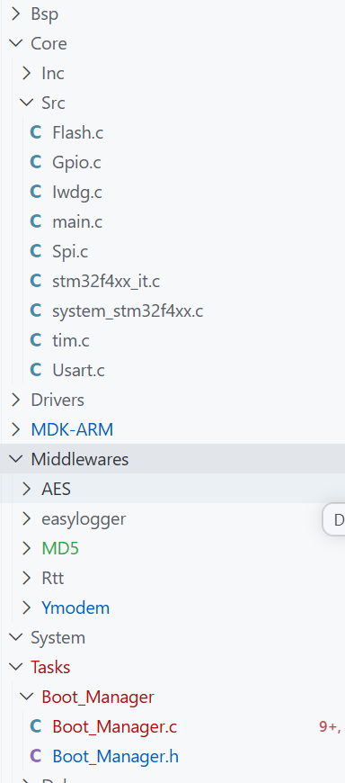

# Bootloader

[← 返回 OTA MOC](../MOC.md) | [← 返回模块总览](../../MOC.md) | [← 主页](../../../index.md)
[← 返回 OTA 升级](../../../术中自有万钟粟/OTA/MOC.md) |

---

Bootloader 在上电后读取 App 共享标志，根据升级状态决定下载镜像、从外部 Flash 搬运镜像、执行回滚或跳转到 App。片内 Flash 擦写通过弱挂载函数交给具体芯片工程实现，Bootloader 模板本身不绑定芯片 Driver。



需要注意的是,他需要复制一分ymodem和app区分出来的,用来所有app都损毁的时候兜底下载

## 关键文件

- [Boot_Manager.h](./Boot_Manager.h) / [Boot_Manager.c](./Boot_Manager.c)：
  Boot_Manager_State主要负责函数,负责搬运镜像等工作
  把当前的加密文件解密到运行区app,然后重置
  看门狗不通过就回滚
  看门狗通过,app就会写APP_AreaAToAreaB把运行区备份一下
  看门狗和回滚都不通过就进入兜底ymodem下载
  上面的__weak函数是目前缺失的,直接填写就好
- [ota_config.h](../ota_config.h)：
  定义 Bootloader、App、应用标志区和外部 Flash A/B 区地址及容量。

## 启动流程

```text
Boot_Manager_State
  -> 读取 App_RunState
  -> APP_WAIT_UPDATE
       -> 读取外部 Flash A 区镜像
       -> 写入 App 区
       -> 检查 App 向量表
       -> 设置 APP_Check_NewApp
       -> 复位
  -> APP_Check_NewApp
       -> 检查升级结果
       -> 设置 APP_Valid 或执行回滚
       -> 复位
  -> APP_Valid / 默认状态
       -> BootManager_JumpToApp
  -> 标志无效
       -> BootManager_BootDownload
       -> Ymodem_Receive
```

## 底层挂载

- `Flash_erase()`：挂载片内 Flash 擦除实现。
- `Flash_Write()`：挂载片内 Flash 写入实现。
- `Flash_Read()`：挂载片内 Flash 读取实现。
- `boot_system_reset()`：挂载芯片复位接口。
- `boot_jump_to_app()`：挂载向量表、MSP 和复位向量跳转实现。
- `boot_aes_init()`：挂载产品的升级校验环境初始化。
- `extern_flash_read()`：按 A/B 分区绝对地址读取外部 Flash 镜像。
- `Flash_erase()`、`Flash_Write()`、`Flash_Read()`：挂载片内 Flash 的阻塞式擦除、写入和读取。
- `AES`、`MD5`：解密镜像并校验应用数据完整性。

Ymodem 保持现有实现，Bootloader 只调用 `Ymodem_Receive()`，不修改协议模块。
