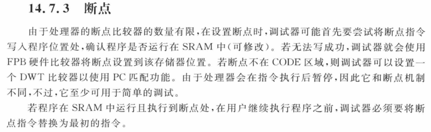
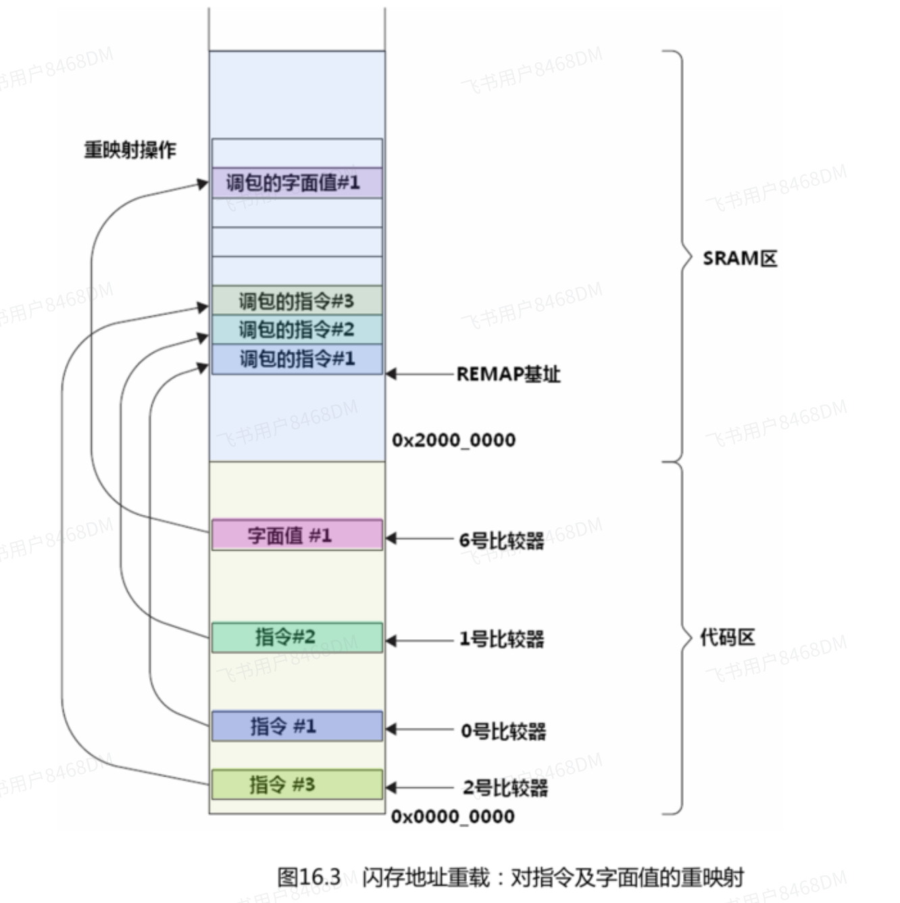
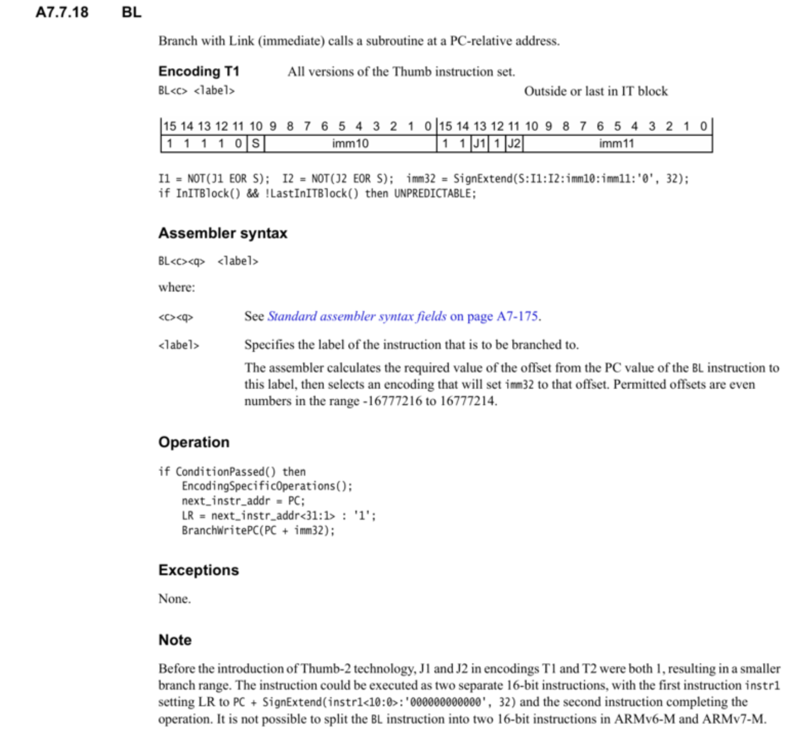

# FPB原理

[← 返回 Cortex-M4内核原理](./MOC.md) | [← 主页](../../index.md)

> [移植FPB教程](../debug方法/FBP离线断点.md)

---

FPB（Flash Patch and Breakpoint：Flash 补丁和断点单元）是一个在总线上的外设，实时监控IBUS,DBUS等（监控但是不会消耗CPU指令周期)，

## FPB 断点功能

断点功能理解起来相对简单：在调试期间，可以在程序地址或数据地址处设置一个或多个断点。若执行了断点地址处的程序代码，则会触发断点调试事件并暂停程序执行（暂停模式调试），或触发调试监控异常（若使用调试监控）。之后就能检查寄存器的内容、存储器和外设，并可以利用单步进行调试等。

FPB 主要有两个功能：

- 提供硬件断点特性。提供处理器内核的断点事件，触发暂停模式或调试监控异常等调试模式。
- 通过将 CODE 区域内的存储器访问映射到 SRAM 区域（存储器空间的下一个 0.5 GB），实现对指令或数据的补丁。

《Cortex-M3 与 M4 权威指南》中对断点有如下描述。



程序指令可能运行在 SRAM 中，也可能运行在 Flash 中。设置断点时，调试器会尝试把断点指令（也就是前面介绍的 BKPT 指令）写入程序位置处。若程序在 Flash 中（不可修改），无法成功写入断点指令，则会使用 FPB 单元来设置断点；若程序在 SRAM 中（可修改），可以成功插入断点指令。程序继续运行之前，断点指令将被替换为原始指令。

## FBP指令重映射功能

《Cortex-M3 与 M4 权威指南》中对令重映射功能描述：

```
使用这个重映射功能，可以创建一些“如果...将会...”(what if) 形式的测试——通过把原始指令或字面值取代成另一个来实现。
并且即使是在ROM或flash中运行的代码，也能够参与此种测试。
另一种用法在本质上与这种用法相同，但被取代的是跳转指令，因此行为很像“狸猫换太子”：

对于某个位于flash中的子程序，在SRAM中提供一个冒充它的。
通过闪存地址重载，使得在执行到调用该子程序的指令(BL)时，实际上执行的是被“调包”过的，位于SRAM中的BL，后者则跳转到“狸猫”中。
这种机制使得基于ROM的设备也可以调试（修改过的子程序暂时放到SRAM中）。
```



> 用处：为了降低成本，某些程序可能烧写在单次可编程的ROM中，
> 程序一旦写入便无法更改，若在量产之后发现软件存在bug，更换全部设备需要付出巨大成本，
> 如果使用FPB的重映射功能，便可以使用重映射功能来实现程序补丁，以此来修复bug，并节省成本。

但是跳转过去，需要算出相对位移： [ARM的B,BL跳转指令偏移值计算](https://www.cnblogs.com/from-zero/p/13752017.html "发布于 2020-09-29 21:26")
然后把相对位移放到机器码里：
再把算好的这 4 字节机器码，写到 FPB 的 FP_REMAP 指向的 SRAM 空间里。

跳转回来只需要用PC跳转（注意Thumb 指令集bit0为1）或者直接“*”函数指针跳回来
