# HRTIM高分辨定时器

[← MOC](MOC.md) | [← 主页](../../../index.md)

---

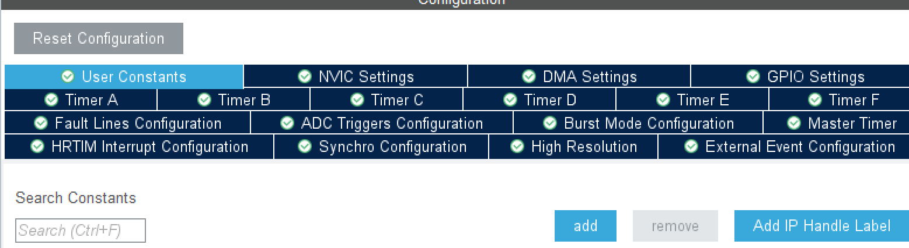

```
HRTIM1
├─ Master Timer     总节拍、发同步/复位、产生公共事件，一般不接输出引脚
├─ Timer A          完整定时器：计数器 + 4 比较 + 2 捕获 + 2 输出
├─ Timer B          同上
├─ Timer C          同上
├─ Timer D          同上
├─ Timer E          同上
└─ Timer F          同上
共享：高精度时钟 fHRCK、外部事件、故障输入、ADC 触发、Burst、同步信号
```

为了**多路输出和相位关系**,设置多个定时器

## User Constants — 用户常量

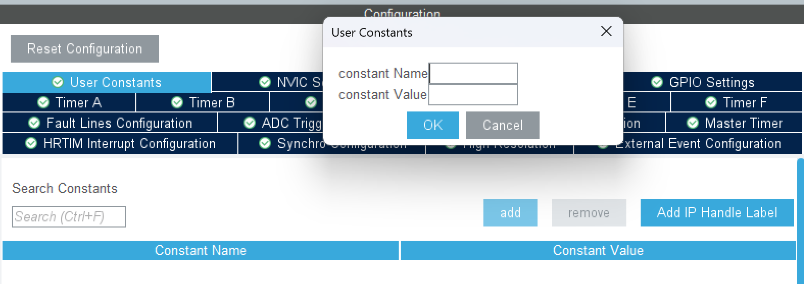

定义生成代码中使用的用户常量，例如周期计数、比较值或分频参数。它负责给数值命名，本身不会启用计数器、输出或中断；常量需要被相应配置或代码引用后才起作用。
一般不用

## NVIC Settings — 中断控制器配置

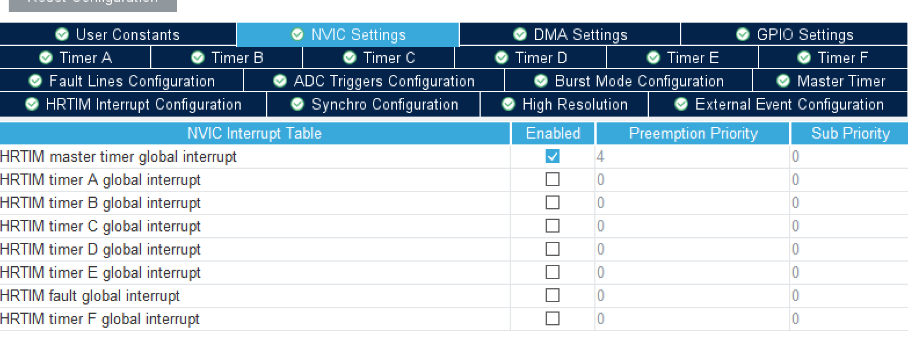

定时器中断是否打开,还有一个fault是其余事件的中断入口,比如错误等公共事件

这里不是定时器是否打开,
定时器是可以,打开,并且定时器中断不开的,根据定时器的时间,外设会自动运行的,所以不需要开定时器中断,
如果开了,还要再定义一个HTRIM定时器中断入口,独立于HTRIM主中断入口的

各定时器中断可以分别使能，只开实际用到的那几个即可。

## DMA Settings — DMA 配置

为 HRTIM 的 DMA 请求分配 DMA 通道或数据流，并配置传输方向、数据宽度、地址递增、循环模式及优先级等。

常用于在周期或比较事件发生时搬运数据，例如更新比较寄存器以改变 PWM 占空比。

## GPIO Settings — 引脚配置


| 选项                   | 意思                                                                        |
| ---------------------- | --------------------------------------------------------------------------- |
| Pin Name               | 引脚的名字，比如 PA8、PB12，就是芯片上具体的那个脚。                        |
| Signal on Pin          | 这个脚当前分给了什么信号，比如 HRTIM1_CHA1、GPIO_Output；没有就是还没分配。 |
| GPIO output level      | 当这个脚配成普通输出时，默认输出高电平还是低电平。                          |
| GPIO mode              | 引脚的工作模式，比如输入、推挽输出、开漏输出、复用推挽/开漏、模拟。         |
| GPIO Pull-up/Pull-down | 芯片内部给这个脚接的上拉或下拉电阻，也可以选不接。                          |
| Maximum output speed   | 输出翻转时边沿的快慢档位，一般分 Low、Medium、High、Very High。             |
| Fast Mode              | 快速模式+，主要是给 I2C 引脚提速到 1 MHz 用的开关，别的脚用不上。           |
| User Label             | 自己给这个脚起的名字，方便看代码和原理图，不影响硬件。                      |
| Modified               | 表示这个脚的配置有没有被改过，只是个标记。                                  |

`HRTIM1_CHA1` 是引脚上复用的信号名，拆开看：

- `HRTIM1`：第 1 个 HRTIM 外设实例。
- `CH`：channel，输出通道。
- `A`：Timer A，HRTIM 有 A～F 六个子定时器。
- `1`：这个子定时器的第 1 路输出。

所以看到 `HRTIM1_CHA1`，就表示这个脚被分给了 HRTIM1 的 Timer A 第一路输出，波形由 Timer A 的比较单元和输出配置决定。`CHA2` 是 Timer A 的第 2 路，通常和 `CHA1` 组成一对互补 PWM；`CHB1`、`CHC1` 同理，只是换成了 Timer B、Timer C。

## Timer A～F — 子定时器配置

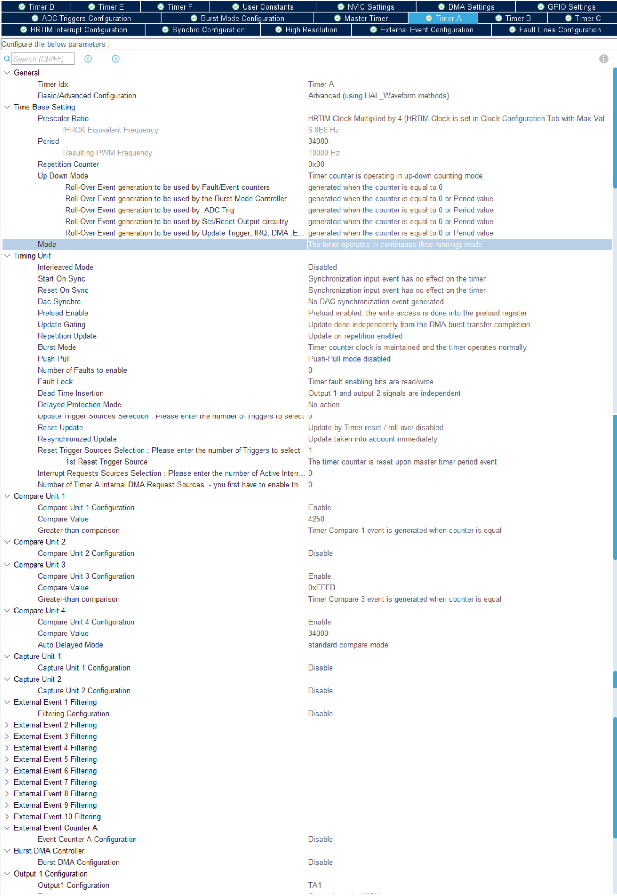

| 分类      | 选项                                 | 意思                                                                                                                                                                                           |
| --------- | ------------------------------------ | ---------------------------------------------------------------------------------------------------------------------------------------------------------------------------------------------- |
| 通用      | Timer Idx                            | 当前配置的是哪个子定时器；Timer A～F 各有一份同样的配置项                                                                                                                                      |
| 通用      | Basic/Advanced Configuration         | 基础模式用图形界面配波形；高级模式改用 HAL 波形 API                                                                                                                                            |
| 时基      | Prescaler Ratio                      | 计数时钟的分频档，可选不分频 / ÷2 / ÷4 等（档位随芯片而定）；分得越大周期范围越长、精度越粗                                                                                                  |
| 时基      | fHRCK Equivalent Frequency           | 分频后实际的计数时钟频率，只读，用来换算周期长度和分辨率                                                                                                                                       |
| 时基      | Period                               | 一个 PWM 周期的计数值，0x0001～0xFFFF；和计数频率一起决定输出频率                                                                                                                              |
| 时基      | Resulting PWM Frequency              | 由计数频率和 Period 算出的实际频率，只读                                                                                                                                                       |
| 时基      | Repetition Counter                   | 重复计数 N，每 N+1 个周期产生一次重复事件；填 0 表示每个周期都有                                                                                                                               |
| 时基      | Up Down Mode                         | 向上：0 数到 Period。<br />向下：Period 数到 0<br /><br />上下：0→Period→0，即中心对齐, 同一个比较值上升、下降各命中一次，比较事件关于周期中点对称；波形还要看输出置位/复位配置。           |
| 时基      | Roll-Over Event ×5                  | 计数器走到头回卷（roll-over）的时刻。<br />向上数到 Period 回 0；上下计数时 0 和 Period 两个端点都算。<br />勾选后把这个时刻给故障/事件计数、Burst、ADC 触发、输出置位复位、更新/中断/DMA 用。 |
| 时序单元  | Interleaved Mode                     | 交错模式，把比较点按周期等分。<br />Half：CMP1=1/2 周期。<br />Triple：CMP1=1/3、CMP2=2/3。<br />Quad：CMP1=1/4、CMP2=2/4、CMP3=3/4。<br />用来做多相错相,每个CMP可以触发一个事件              |
| 时序单元  | Start On Sync                        | 收到同步信号才开始计数。<br /><br />信号到来， **启动计数** ；已在运行则继续，不清零<br /><br />同步的意思是其他的定时器也收到了这个信号                                                 |
| 时序单元  | Reset On Sync                        | 信号到来，**计数器清零** ；运行中也会清零，重新对齐时序。<br /><br />全部清零停止                                                                                                        |
| 时序单元  | Dac Synchro                          | 每次更新事件是否给 DAC 发同步触发：开 / 关                                                                                                                                                     |
| 时序单元  | Preload Enable                       | 参数先写进预装载寄存器，等更新事件才生效：开 / 关                                                                                                                                              |
| 时序单元  | Update Gating                        | 更新是否要等 DMA 成组传输（Burst DMA）搬完才生效：开 / 关                                                                                                                                      |
| 时序单元  | Repetition Update                    | 重复事件时是否把预装载值刷到活动寄存器：开 / 关                                                                                                                                                |
| 时序单元  | Burst Mode                           | 突发模式空闲窗口期间，该定时器计数器继续跑还是停住清零；总开关在 Burst Mode Configuration 里                                                                                                   |
| 时序单元  | Push Pull                            | 推挽模式开关：开 / 关                                                                                                                                                                          |
| 时序单元  | Number of Faults to enable           | 该定时器启用几路故障输入：0～6                                                                                                                                                                 |
| 时序单元  | Fault Lock                           | 故障使能位是只读还是可写：只读 / 可写                                                                                                                                                          |
| 时序单元  | Dead Time Insertion                  | 输出 1、2 之间插死区，防止上下管直通：开 / 关                                                                                                                                                  |
| 时序单元  | Delayed Protection Mode              | 故障后延迟一段时间再把指定输出切到空闲：开 / 关                                                                                                                                                |
| 时序单元  | Update Trigger Sources               | 选几个更新触发源（数量）+ 每个源是什么：Master 周期/比较、其他 Timer、外部事件等                                                                                                               |
| 时序单元  | Reset Update                         | 复位或回卷时是否执行更新：开 / 关                                                                                                                                                              |
| 时序单元  | Resynchronized Update                | 外部更新立刻生效，还是等下次复位/回卷：立即 / 下次                                                                                                                                             |
| 时序单元  | Reset Trigger Sources                | 选几个复位触发源（数量）+ 每个源是什么：Master 周期/比较、其他 Timer、外部事件等                                                                                                               |
| 时序单元  | Interrupt Requests Sources           | 选几个事件产生中断请求：周期、比较、重复、捕获、故障等                                                                                                                                         |
| 时序单元  | Timer A Internal DMA Request Sources | 选几个事件产生 DMA 请求：周期、比较、重复、捕获等                                                                                                                                              |
| 比较单元  | Compare Unit 1~4                     | 四个比较单元，每个可设比较值、比较方式和自动延迟                                                                                                                                               |
| 捕获单元  | Capture Unit 1~2                     | 捕获外部事件到来时的计数值                                                                                                                                                                     |
| 外部事件  | External Event 1~10 Filtering        | 10 路外部事件输入各自的数字滤波档位（关 / 若干个采样点）                                                                                                                                       |
| 外部事件  | Event Counter A                      | 外部事件计数器，统计事件来了多少次                                                                                                                                                             |
| Burst DMA | Burst DMA Controller                 | HRTIM 成组寄存器 DMA 传输的开关：开 / 关                                                                                                                                                       |
| 输出      | Output 1 Configuration               | 输出 1 的置位/复位源、极性、空闲电平                                                                                                                                                           |

## Fault Lines Configuration — 故障输入配置

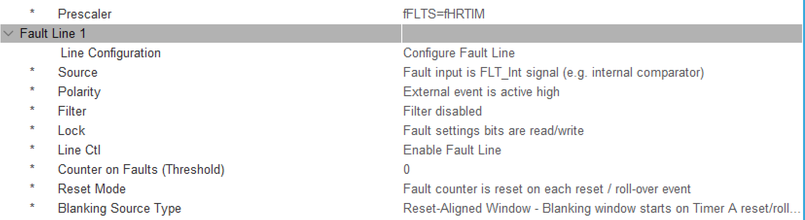

配置故障信号的来源、有效极性、数字滤波及锁定等属性，用于连接过流、过压或驱动器故障信号。

公共故障输入配置完成后，还要在相关 Timer 中选用故障源并设置输出保护状态。保护可直接由硬件执行，中断用于通知软件处理和记录故障，不承担第一时间关断的职责。

| 选项                          | 说明（可选值）                                                                          |
| ----------------------------- | --------------------------------------------------------------------------------------- |
| Prescaler                     | 故障采样的基准时钟快慢：<br />不分频 / ÷2 / ÷4 / ÷8。分得越慢，抗噪越强、反应越慢    |
| Line Configuration            | 这一路启用配置或不启用：不配置 / 配置                                                   |
| Source                        | 故障信号从哪来：<br />专用故障引脚 / 片内信号（如比较器）/ 借用第 n 路外部事件          |
| Polarity                      | 高电平算故障，还是低电平算故障                                                          |
| Filter                        | 防抖：关掉 / 连续采 2、4、8… 个点才算数（越多数越稳、越慢）                            |
| Lock                          | 这些设置能不能被程序改：能改 / 锁死（只有复位能解）                                     |
| Line Ctl                      | 这一路使能 / 不使能                                                                     |
| Counter on Faults (Threshold) | 连续来几次才算真故障，0～15（填 0 就 1 次算）                                           |
| Reset Mode                    | 计数器何时清零：每周期都清 / 上周期没故障才清                                           |
| Blanking Source Type          | 屏蔽窗口怎么划：从周期起点开始 / 从固定比较点开始。<br />窗口内不认故障，用来躲开关噪声 |

## ADC Triggers Configuration — ADC 触发配置

选择哪些 HRTIM 事件生成 ADC 触发信号，例如周期事件或比较匹配事件，使采样点固定在 PWM 周期的指定位置。

HRTIM 侧配置触发源，ADC 侧选择对应的外部触发信号及边沿；两侧匹配并启动 ADC 后，才能完成硬件触发采样。电机控制中常将采样点安排在开关噪声较小且电流可测的时间窗口

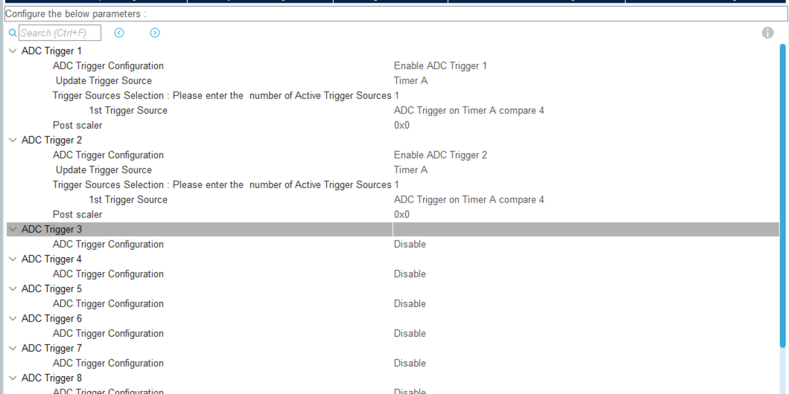

## Burst Mode Configuration — 突发模式配置

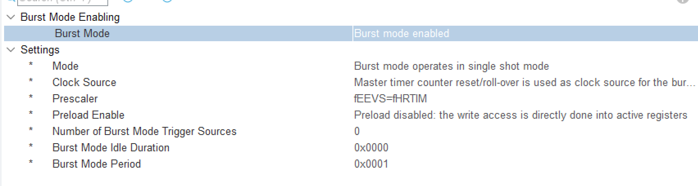

将输出工作划分为活动窗口和空闲窗口，让一组 PWM 脉冲间歇出现。主要涉及突发计数时钟、周期、活动窗口长度、触发方式，以及参与突发模式的定时器。

常用于轻载降功耗或间歇驱动。空闲窗口内的输出状态需要结合各 Timer 的空闲配置确定

这里的 Burst Mode 指间歇工作模式，与[DMA 成组寄存器传输的 Burst 功能](../DMA.md#原理)需区分

| 配置项                               | 说明                                                                                                        |
| ------------------------------------ | ----------------------------------------------------------------------------------------------------------- |
| Burst Mode（Burst Mode Enabling）    | 总开关。启用后按活动窗口/空闲窗口间歇运行；禁用后按普通连续模式运行                                         |
| Mode                                 | 运行方式：连续模式 / 单次触发（Single Shot，由触发启动一段突发序列后进入空闲）                              |
| Clock Source                         | 突发计数器的时钟来源：Master 的周期或回卷事件 / 各 Timer 的周期或回卷事件 / 外部事件等                      |
| Prescaler                            | 突发计数时钟分频档；分得越大空闲时长和周期能设得越长，计时粒度越粗                                          |
| Preload Enable                       | 是否用预装载寄存器：启用后新参数在更新事件统一生效，禁用则直接写活动寄存器                                  |
| Number of Burst Mode Trigger Sources | 要配几个触发源：0～32，填 0 表示不配触发源                                                                  |
| Burst Mode Idle Duration             | 空闲窗口长度：0x0000～0xFFFF，单位是突发计数时钟                                                            |
| Burst Mode Period                    | 突发模式总周期：0x0001～0xFFFF，单位是突发计数时钟                                                          |
| Timer Burst Mode                     | 各 Timer 是否参与突发模式：参与的在空闲窗口把输出保持在各自 Idle 电平（0 或 1），未参与的继续按普通配置输出 |

`Burst Mode Period` 与 `Burst Mode Idle Duration` 一起决定活动/空闲窗口的节奏；空闲窗口里输出到底是高还是低，仍由各 Timer 的空闲电平、空闲模式和故障配置决定。

## Master Timer — 主定时器配置

Master 通常用于确定整组波形的周期、子定时器复位时刻或相位参考，不直接对应 A～F 的输出引脚。子定时器是否跟随 Master，需要在各自的事件和复位配置中指定

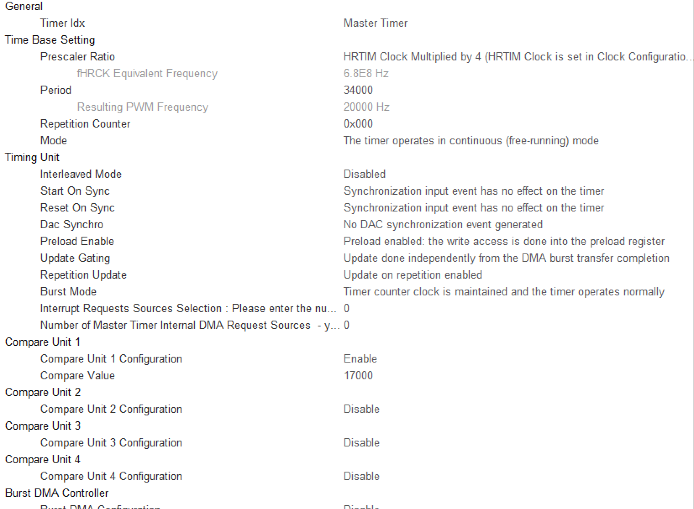

| 分类     | 选项                                                | 意思及可选值                                                                        |
| -------- | --------------------------------------------------- | ----------------------------------------------------------------------------------- |
| 通用     | Timer Idx                                           | 当前配置的是哪个定时器；Master 和 Timer A～F 各有一份                               |
| 时基     | Prescaler Ratio                                     | 计数时钟的分频/倍率档位，决定计数的时间刻度                                         |
| 时基     | fHRCK Equivalent Frequency                          | 分频后的等效计数频率，只读                                                          |
| 时基     | Period                                              | 周期计数值 0x0001～0xFFFF，和计数频率一起决定周期时长                               |
| 时基     | Resulting PWM Frequency                             | 由计数频率和周期算出的频率，只读；Master 不直接接输出引脚                           |
| 时基     | Repetition Counter                                  | 重复计数 N，每 N+1 个周期产生一次重复事件；填 0 表示每个周期一次                    |
| 时基     | Mode                                                | 连续运行 / 单次运行；连续模式到周期末自动回卷继续计数                               |
| 时序单元 | Interleaved Mode                                    | 自动把比较点按周期等分：Half 二分之一、Triple 三分之一、Quad 四分之一，用于交错时序 |
| 时序单元 | Start On Sync                                       | 同步输入到来时是否启动计数：开 / 关                                                 |
| 时序单元 | Reset On Sync                                       | 同步输入到来时是否清零计数器：开 / 关                                               |
| 时序单元 | Dac Synchro                                         | 是否产生给 DAC 用的同步事件：开 / 关                                                |
| 时序单元 | Preload Enable                                      | 新参数先放预装载寄存器，等更新事件再生效：开 / 关                                   |
| 时序单元 | Update Gating                                       | 寄存器更新是否要等 DMA 成组传输完成：开 / 关                                        |
| 时序单元 | Repetition Update                                   | 重复事件时是否把预装载值刷到活动寄存器：开 / 关                                     |
| 时序单元 | Burst Mode                                          | 突发模式空闲窗口期间，该定时器的计数行为：继续计数 / 停住清零                       |
| 事件请求 | Interrupt Requests Sources Selection                | 选几个 Master 事件产生中断请求：周期、比较、重复等                                  |
| 事件请求 | Number of Master Timer Internal DMA Request Sources | 选几个 Master 事件产生 DMA 请求：周期、比较、重复等                                 |
| 比较单元 | Compare Unit 1～4 Configuration                     | 分别启用或关闭四个比较单元                                                          |
| 比较单元 | Compare Value                                       | 计数器到该值时产生比较事件；是否改变子定时器输出，取决于子定时器的事件配置          |
| 成组传输 | Burst DMA Controller / Burst DMA Configuration      | HRTIM 成组寄存器 DMA 传输的开关和细节；与上面间歇工作的 Burst Mode 是两回事         |

Master 的周期事件可以当整组波形的节拍，比较事件常用来复位子定时器或触发采样。要用它控制子定时器的周期或相位，还需在子定时器中选用对应的 Master 周期/比较事件。

## HRTIM Interrupt Configuration — 外设中断源配置

选择 HRTIM 内部哪些事件产生中断请求，例如周期、比较匹配、重复计数、捕获或故障事件，具体项目以界面提供的选项为准。

它与 NVIC Settings 分工不同：这里开放外设事件到中断请求的通路，NVIC 决定 CPU 是否响应及响应优先级。程序还需正确启动带中断功能，并在中断处理函数中处理、清除相应标志。

## Sync Configuration — 同步配置

配置同步输入、同步输出及相关信号源，使 HRTIM 与其他定时器或外部设备对齐时间基准。

常见内容包括同步输入源、有效边沿、同步输出源及极性。

用于多控制器、多电源模块或多组波形协同。同步信号建立后，还要配置相关计数器对同步事件的响应，才能实现同步启动或复位。

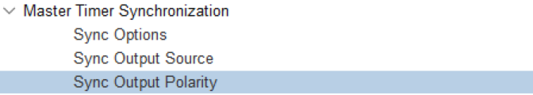

| 选项                 | 说明（可选值）                                                                                                                         |
| -------------------- | -------------------------------------------------------------------------------------------------------------------------------------- |
| Sync Options         | 这个 HRTIM 在同步里扮演什么角色：<br />不使用同步（独立运行）/ 只当主（产生 SYNCOUT）/ 只当从（吃 SYNCIN）/ 既当主又当从               |
| Sync Output Source   | 主模式下 SYNCOUT 何时发一个脉冲（宽度 16 个 fHRTIM 周期）：<br />Master 启动事件 / Master 比较 1 / Timer A 启动或复位 / Timer A 比较 1 |
| Sync Output Polarity | 这个同步脉冲的极性：关闭（不发脉冲）/ 正脉冲 / 负脉冲                                                                                  |

选成“从”或“主+从”时，才会多出 `Sync Input Source`（不配 / 片上定时器 / SYNCIN 引脚正脉冲）和有效边沿相关的项。

## High Resolution — 高分辨率配置

使用高分辨率功能前，需要完成相应校准并确认就绪。实际分辨率取决于芯片、HRTIM 时钟及工作条件；高分辨率描述的是边沿定位能力，不代表 CPU 中断也具有同样的响应精度。

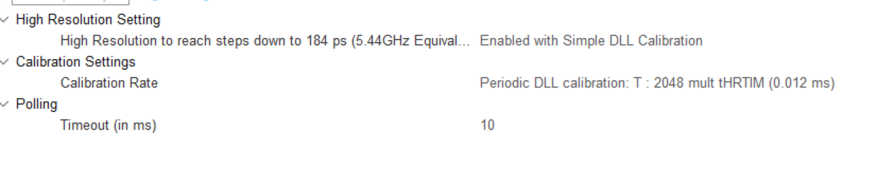

| 选项                                          | 说明（可选值）                                                                                                                                |
| --------------------------------------------- | --------------------------------------------------------------------------------------------------------------------------------------------- |
| High Resolution to reach steps down to 184 ps | 高分辨率功能及 DLL 校准方式：关闭 / 启用并轮询等待校准完成（Simple DLL Calibration）/ 启用并通过中断通知校准完成（Interrupt DLL Calibration） |
| Calibration Rate                              | DLL 校准频率：单次校准 / 每 2048、16384、131072 或 1048576 个 HRTIM 时钟周期校准一次。周期越短，校准越频繁；实际间隔随 HRTIM 时钟变化         |
| Timeout (in ms)                               | 轮询等待校准完成的最长时间：填写毫秒数，允许范围以 CubeMX 输入校验为准；仅轮询校准方式需要此项                                                |

## External Event Configuration — 外部事件配置

配置 EEV 外部事件通道，包括信号来源、有效极性、边沿或电平敏感方式，以及支持的滤波、快速响应等选项。来源可以是引脚或片内外设，具体映射由芯片决定。

配置好的事件可在 Timer 中作为捕获、复位或输出置位/复位的触发条件。例如比较器检测到电流阈值后，通过外部事件直接改变输出，实现硬件逐周期控制。公共事件配置定义信号如何进入，Timer 配置决定收到信号后做什么。

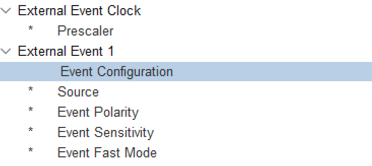

| 选项 | 说明（可选值） |
| ---- | -------------- |
| Prescaler | 外部事件数字滤波采样时钟分频：不分频 / ÷2 / ÷4 / ÷8。相同滤波档位下，分频越大，确认事件所需时间越长 |
| Event Configuration | 是否配置这一路外部事件：不配置 / 配置。各 EEV 通道分别设置 |
| Source | 事件信号来源：外部 EEV 引脚 / 片内信号（如比较器输出）。各通道可选的具体信号由芯片映射决定 |
| Event Polarity | 信号有效极性：高电平有效 / 低电平有效；边沿触发时需结合 Event Sensitivity 理解 |
| Event Sensitivity | 事件检测方式：有效电平 / 上升沿 / 下降沿 / 双边沿。电平方式在信号处于有效电平期间持续有效，边沿方式只在跳变时产生事件 |
| Event Fast Mode | 快速响应：关闭 / 开启。开启后绕过事件同步路径，缩短事件到输出动作的延迟；仅 EEV1～EEV5 支持 |
