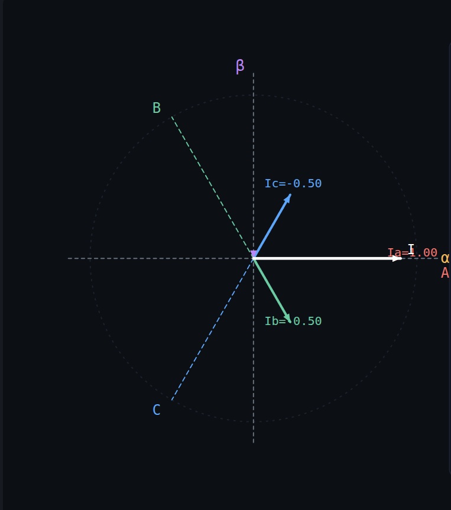
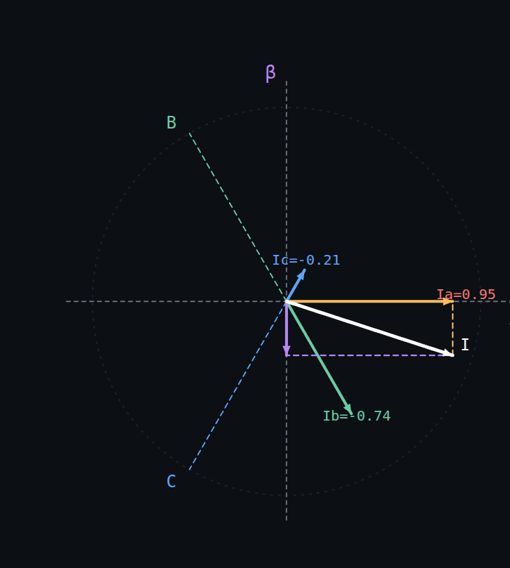

# Clarke变换

[← 返回 FOC MOC](./MOC.md) | [← 返回主页](../../index.md)

> 简单，就是把3个力分解到两个力上
> 然后再乘个系数，缩小一点让合力等于分力的最大值，方便计算，

---

## 模块功能：

* **输入：** 实际三相电流采样值 **$I_a, I_b, I_c$**（通常只需采集两相，**$I_c = -I_a - I_b$**）
* **处理：** **$120^\circ$** 三相轴系投影到 **$90^\circ$** 正交 **$\alpha\beta$** 轴系
* **输出：** 静止坐标系电流分量 **$I_\alpha, I_\beta$**

Clarke变将这三个互相关联的变量，等效为两个在空间上垂直（90度）的独立变量。这大大简化了后续的分析与控制。

## 三、公式推导

坐标系如图：$\alpha$坐标系和A相对齐

那么按照向量，力的合成与分解，就可以把I_B相和I_C相的力分解到$\alpha$和$\beta$轴上

### 等幅值变换：

这里等幅值是指：**3相合力的值==1相的最大值**

所以最后要成2/3

后面算[力矩](电机学基础.md)的时候再乘回来

在绝大多数FOC应用（如无人机电调、伺服驱动器）中，使用**等幅值变换**即可。因为后续的Park变换和SVPWM会进行相应的系数调整，最终控制效果是一致的。等幅值变换计算量更小。

### 等功率变换：

1. 假设电机单相相电压是 $10\text{V}$，相电流是 $10\text{A}$（为了方便，设功率因数等于 1）。在三根物理铜线里，三相电机的真实总功率是：

   $$
   P_{3\phi} = u_a i_a + u_b i_b + u_c i_c = \mathbf{1.5 \times 10\text{V} \times 10\text{A} = 150\text{W}}
   $$

   这是电表上实打实计费的功率：$150\text{W}$。
2. 按你的设想：不乘任何系数，纯矢量合成如果完全不做任何缩放（系数为 1），直接把三相分量投影到 $\alpha$ 和 $\beta$ 轴上：电流的纯力合成：三相协同发力，刚才推导过，水平轴的电流矢量变成了 $1.5$ 倍：

   $$
   i_\alpha = 1.5 \times 10\text{A} = \mathbf{15\text{A}}
   $$

   电压的纯力合成：电压同理，也是空间三相协同，水平轴的电压矢量同样变成了 $1.5$ 倍：

   $$
   u_\alpha = 1.5 \times 10\text{V} = \mathbf{15\text{V}}
   $$
3. 现在看两相平面里算出来的功率：在 $\alpha-\beta$ 平面里，我们用公式计算功率：

   $$
   P_{2\phi} = u_\alpha i_\alpha + u_\beta i_\beta
   $$

   把上面合成出来的数值代进去：

   $$
   P_{2\phi} = (15\text{V}) \times (15\text{A}) = \mathbf{225\text{W}}
   $$

   所以，需要为电流乘$ \mathbf{\sqrt{\frac{2}{3}}}$

## 五、C语言实现（嵌入式级优化）

与 FOC 其他模块(逆Park/SVPWM/电流环)风格统一，这里给出一份面向带FPU的 MCU 的浮点实现，MISRA 风格、带空指针校验、常量乘代替除法。完整文件见 [相关代码/Clarke.c](../../库中车马多如簇/FOC/Clarke.c)，核心逻辑摘录如下：

**优化要点：**

1. **常量乘代替除法**：`1/√3` 和 `1/3` 预计算成浮点常量，MCU的FPU一次 FMUL 比一次 FDIV 快一个数量级。
2. **参数校验前置**：空指针直接返回错误码，避免访存异常。
3. **两种重载**：两相版本依赖 `Ia+Ib+Ic=0`，省一路ADC；三相版本对直流偏置和采样失配更鲁棒，按实际硬件选用。
4. **若无FPU**（Cortex-M0/M3），把浮点常量换成 Q15 定点（`1/√3 ≈ 18918/32768`），用 `(x * 18918) >> 15` 代替乘法即可。
