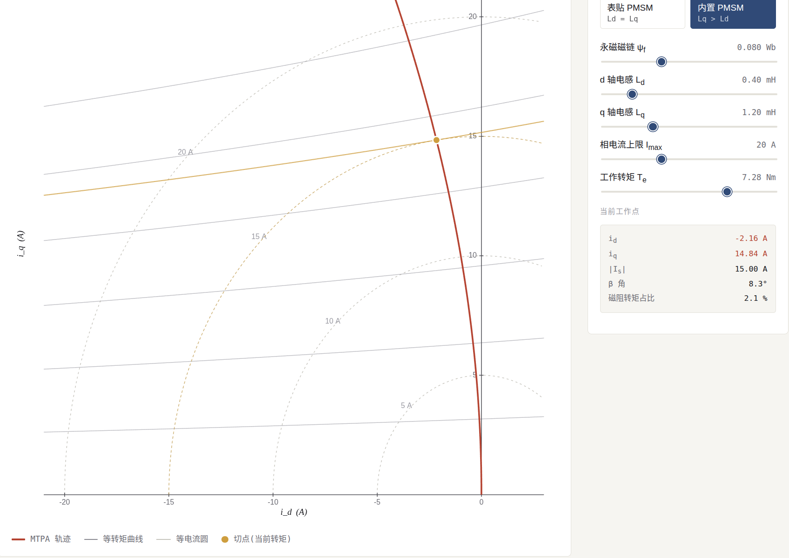
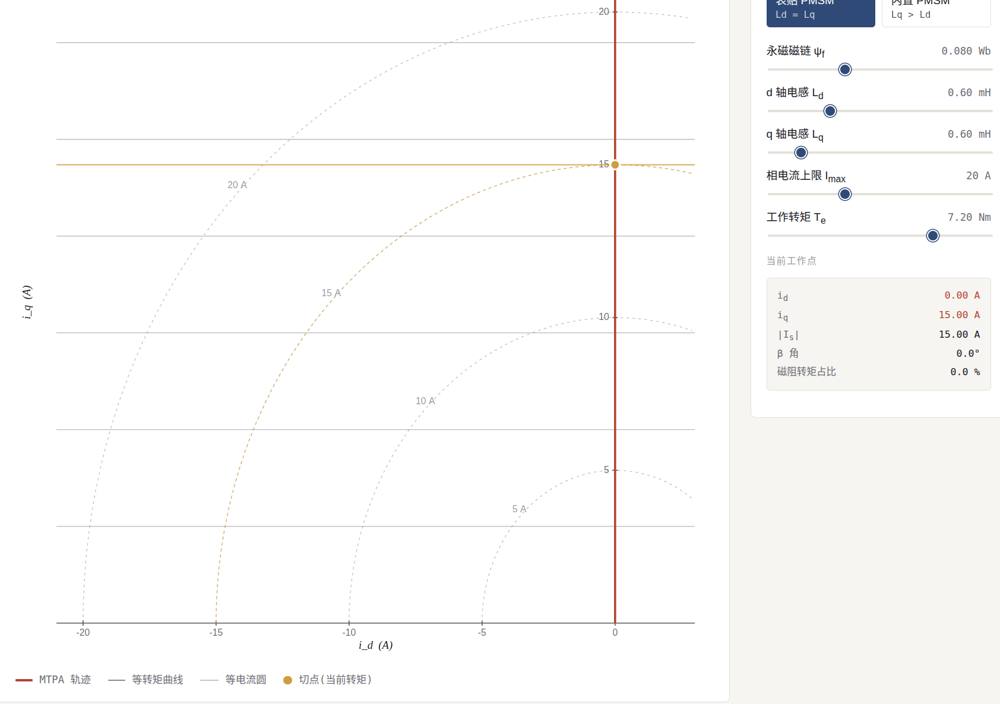

# MTPA磁场定向控制

[← 返回 FOC MOC](./MOC.md) | [← 返回主页](../../index.md)
[电机学基础：磁链、电压与转矩公式](./电机学基础.md#二电磁感应与转矩产生)

---

## 引言：FOC的核心目标

磁场定向控制（Field-Oriented Control, FOC）的核心思想是将电机的定子电流解耦为产生磁场的 直轴电流（$i_d$） 和产生转矩的 交轴电流（$i_q$） 。通过独立控制这两个分量，我们可以像控制直流电机一样高效、精准地控制永磁同步电机（PMSM）或感应电机。本讲将深入探讨两种最核心的电流控制策略： $i_d=0$控制 与 最大转矩电流比控制（MTPA） 。

## 0 第一部分：id=0 控制原理

$i_d=0$控制 是最简单、应用最广泛的FOC控制策略。其核心思想是令直轴电流分量为零（$i_d=0$），将所有定子电流都用于产生转矩（即全部为$i_q$分量）。

### 1.1 基本原理与数学描述

对于表贴式永磁同步电机（SPMSM），通常有 $L_d=L_q$。其转矩方程及推导见[电机学基础：磁链、电压与转矩公式](./电机学基础.md#二电磁感应与转矩产生)。在 $i_d=0$ 时，磁阻转矩项消失，转矩与 $i_q$ 成正比，可实现线性解耦控制。

此时，转矩与交轴电流 $i_q$ 成严格的 正比关系 ，实现了完全的线性解耦控制。

## 第二部分：最大转矩电流比控制（MTPA）原理

[电机学基础：磁链、电压与转矩公式](./电机学基础.md#二电磁感应与转矩产生)这里有写，内嵌式转子，可以通过偏转一点定子磁场方向，利用磁通量更喜欢磁通率高的导体让磁通量无法正常走直线，从而扣出一点扭矩

### 2.1 数学推导与原理

PMSM 的磁链、电压和电磁转矩公式见[电机学基础：磁链、电压与转矩公式](./电机学基础.md#二电磁感应与转矩产生)，这里直接使用其转矩模型。对于凸极电机（$L_d\ne L_q$），转矩包含永磁转矩和磁阻转矩两部分；MTPA 的目标是在满足 $T_e(i_d,i_q)=T_{\text{ref}}$ 的约束下，使电流幅值最小：

$$
I_s^2=i_d^2+i_q^2
$$

通过构造拉格朗日函数求解，可得到 MTPA 轨迹条件：

$$
i_d = \frac{\Psi_f}{L_q - L_d} - \sqrt{\left( \frac{\Psi_f}{L_q - L_d} \right)^2 + i_q^2}
$$

或表示为 $i_d$ 与 $i_q$ 的关系：

$$
i_q^2 = \frac{\Psi_f}{L_q - L_d} i_d - i_d^2
$$

### 2.2 MTPA轨迹可视化



### 2.3 实现方法

MTPA 的实现通常有以下几种方式：

1. **公式计算法**：在线由上述轨迹公式直接解析，由转矩指令 $T_{\text{ref}}$ 算出最优 $i_{d,\text{ref}}$ 和 $i_{q,\text{ref}}$。对参数温漂 / 电感饱和敏感时首选。
2. **查表法**：离线按参数预算 MTPA 轨迹，制成表格烧进 Flash，运行时查表 + 线性插值。参数固定场合最省算力。
3. **搜索法**：在线小幅扰动 $i_d$，观察 $T_e / |I_s|$ 变化，向比值增大的方向调整 $i_d$。收敛慢且易被噪声干扰，工程里少见。

## id=0 与 MTPA 对比与应用选择

| 对比维度   | $i_d=0$ 控制                                                      | MTPA 控制                                        |
| ---------- | ------------------------------------------------------------------- | ------------------------------------------------ |
| 核心思想   | 令直轴电流为零，全部电流用于产生转矩                                | 优化$i_d$和$i_q$分配，使单位电流产生转矩最大 |
| 数学复杂度 | 简单，线性关系                                                      | 复杂，涉及非线性方程或查表                       |
| 计算资源   | 需求低                                                              | 需求较高（计算或存储）                           |
| 电机类型   | 最适合SPMSM ($L_d = L_q$) | 最适合IPMSM ($L_d < L_q$)，优势明显 |                                                  |
| 效率与发热 | 一般，铜耗相对较大                                                  | 优，相同转矩下电流最小，铜耗低                   |
| 控制性能   | 动态响应好，稳定                                                    | 动态响应可能略慢，但稳态效率高                   |
| 典型应用   | 风扇、泵、低成本驱动器、SPMSM                                       | 电动汽车、伺服系统、机器人、IPMSM                |

---

## 相关代码

- [mtpa.c](../../库中车马多如簇/FOC/mtpa.c) — **以中间件形式挂在速度环与电流环之间**:启用则 `mtpa_apply(te_ref, &id_ref, &iq_ref)` 一行完成,不启用自动退回 $i_d=0$,电流环接口完全不动。内部通过 `MTPA_USE_LUT` 宏切换「公式法 / 查表法」
- [current_loop.c](../../库中车马多如簇/FOC/current_loop.c) — 下游电流环,无论是否挂 MTPA 都只认 $(i_d^*, i_q^*)$
- [speed_loop.c](../../库中车马多如簇/FOC/speed_loop.c) — 上游速度环,启用 MTPA 时输出语义升级为转矩指令

### 中间件挂载方式

MTPA 不改电流环接口，只是把速度环的输出语义从「$i_q$ 指令」换成「转矩指令」，中间插一级 MTPA 吐出 $(i_d, i_q)$：

```
不挂 MTPA / id=0 控制:
  ω* ─▶[speed_loop]─▶ iq* ──────────────────▶[current_loop]
                      id* = 0 ────────────────▶

挂上 MTPA 作为中间件:
  ω* ─▶[speed_loop]─▶ Te* ─▶[ mtpa_apply ]─▶ id* ─▶[current_loop]
                                            └▶ iq* ─▶
```

启用:速度环改输出转矩,`mtpa_apply(te_ref, &id_ref, &iq_ref)` 一行搞定。
不启用:整个 `mtpa_apply` 调用链不编译,系统自动退回 $i_d=0$ 控制,电流环代码一个字都不用动。
