# 分享1：机器人无刷力矩电机选型及应用（20261029）
[← MOC](MOC.md) | [← 主页](../../index.md)

---

| 分享人 | Ada |
| --- | --- |
| 部门 | 大硬件电机组 |
| 时间 | 2026年10月29日 |
| 地点 | 苏州办公室/线上 |

> 摘要：针对机器人用无刷力矩**电机**展开介绍，主要内容包括：
>
> 1. 介绍人形机器人主要应用的电机种类，并简要概述电机应用部位及功能概述；
> 1. 介绍电机相关主要术语及定义，拉齐电机VS机器人主要指标术语及其定义，方便协作沟通；
> 1. 明确电机选型时，需要提出&关注的指标，便于选型和设计。

## 人形机器人用电机介绍

电机发展上百年，类型非常繁杂，在人形机器人领域，采用何种电机最优，还在摸索中。

截至当前，行业内大关节路线较为清晰，灵巧手关节还未收敛，但所有关节的设计人员还在不断的创新摸索。下面：

- 简要介绍电机分类
- 介绍人形机器人使用电机类型及应用部位

### 电机分类

电机的分类角度很多，一般会根据能量转换、运行原理、激励源、运动方式等，本文将主流分类进行简要说明。

以机器人关节主要应用的***永磁无刷力矩电动机***为例，下树状图中绿色标识，就是他的分类特点。

可见，电机的细分很多，就是在名称前不停的增加定语。

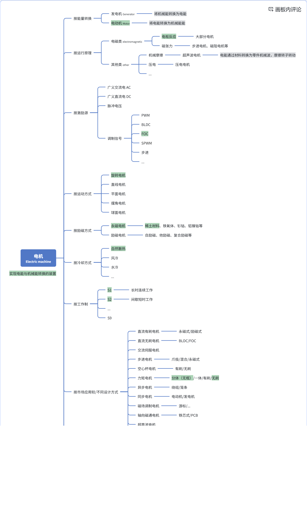

### 人形机器人使用电机类型及应用部位

人形机器人的动力系统，一般分为两大部分：身体及末端执行器（灵巧手）。其应用的电机类型、要求差距极大，故要分为两个系统进行讨论。

#### 身体大关节用电机类型和部位

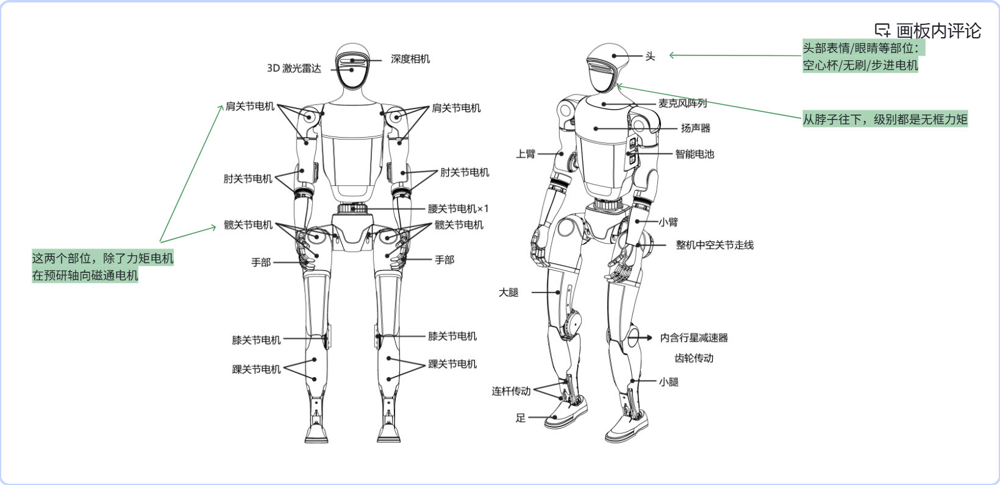

#### 灵巧手用电机类型和部位

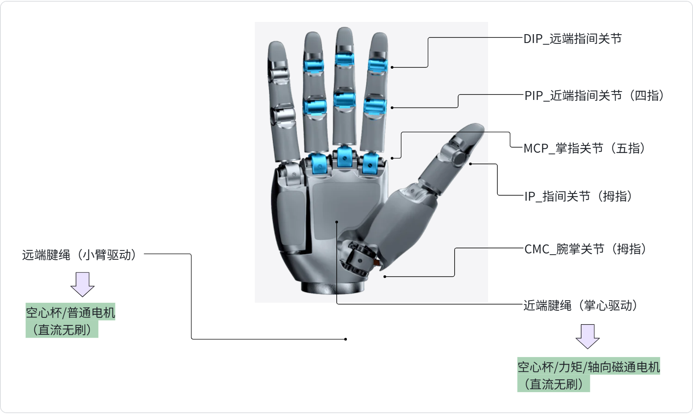

#### 机器人用电机的细节区别

工业机器人、协作机器人、人形机器人都是机器人，但应用的电机类型不同，他们都用什么电机？为什么选择不同类型电机？这些电机系统的区别是什么？

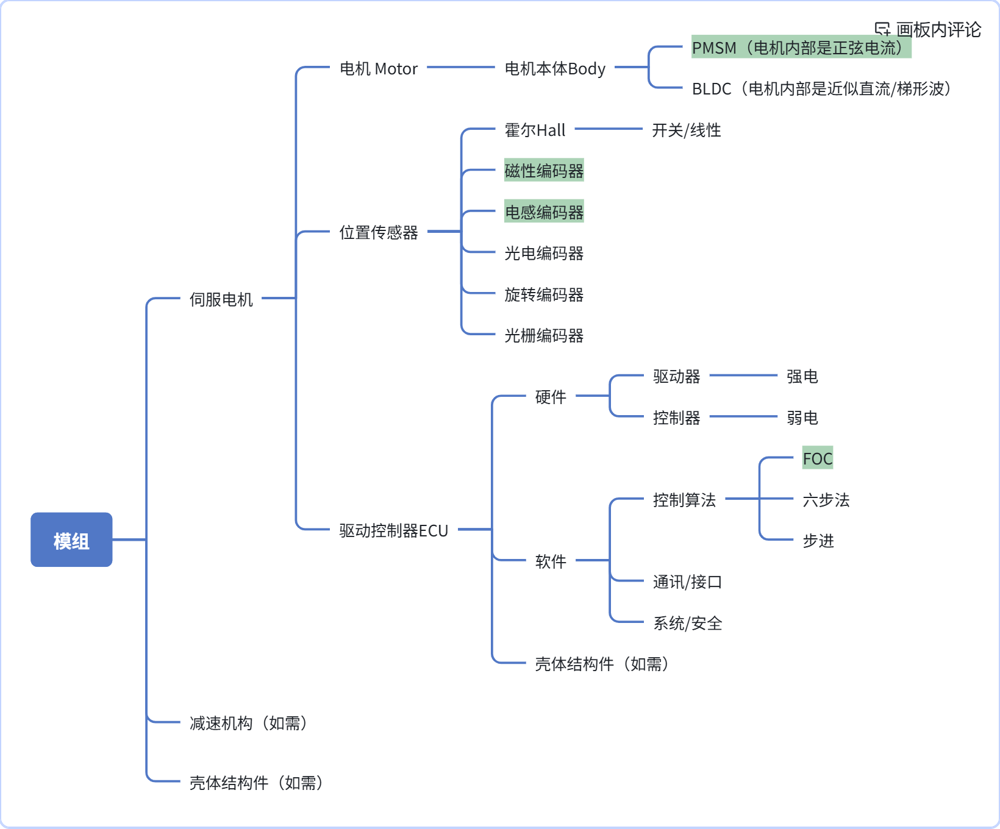

##### 他们都用什么电机？为什么选择不同类型电机？

- 由于体积、电源等要求不同，不同机器人选择不同的ECU布置（分布式/集中式）；
- 由于布置空间大小、形状不同，对电机功率密度要求不同，不同机器人选择不同电机类型（普通/力矩/空心杯等）；
- 由于控制精度/控制要求不同，ECU选择不同的控制算法和调制方式；（FOC/六步法，PWM/SVPWM等）；
- 由于不同控制精度、布置空间要求，选择不同的位置传感器。

##### 这些伺服电机的区别是什么？

从上面分析可见，主要的伺服电机有三种交流伺服电机/直流无刷电机（FOC）/直流无刷电机（六步法），从原理、结构设计、电磁设计、软硬件设计、内特性，三者差距比较大，是专业设计人员的技术范畴。

如果单从非专业人员，使用电机而言，三者的外特性差异不大。

- **相同点——工作特性基本相同，也就说再基础选型中，很多特性都是共用的**

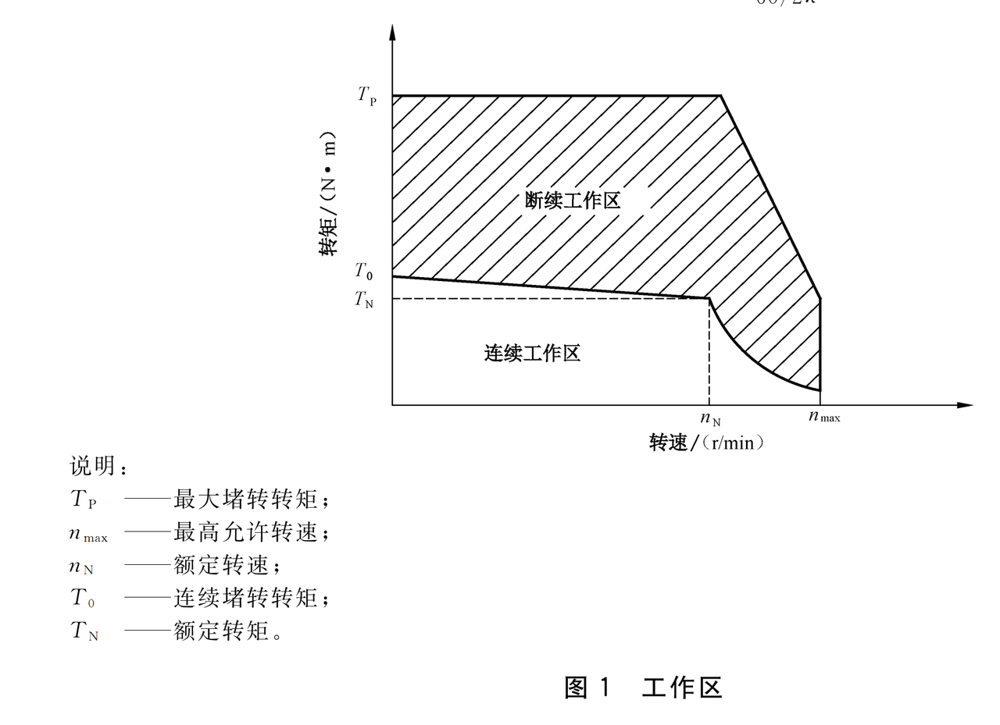

- **不同点——电机部分性能的优劣势不同，选型中，要根据系统的要求，针对性选择。**

PS.以下区分是指主流、相对的，并非绝对的。

| 特性 | 交流伺服电机（FOC） | 直流无刷电机（FOC） | 直流无刷电机（六步法） |
| --- | --- | --- | --- |
| 供电电源 | 交流AC | 直流DC | 直流DC |
| 控制精度 | 高 | 高/中 | 低 |
| 成本 | 高 | 高/中 | 低 |
| 布置空间 | 大 | 中/小 | 小 |
| 转矩波动 | 小 | 小/中 | 大 |
| 功率密度 | 低/中/高 | 中/高 | 低/中 |

## 电机相关指标&术语

### 依据

| 序号 | 标准号 | 名称 | 备注说明 | 标准附件 |
| --- | --- | --- | --- | --- |
| 1 | GB/T 755-2025 | 旋转电机 额定与性能 | 基础标准/优先考虑 |  |
| 2 | GB/T 2900.25-2008 | 电工术语  旋转电机 | 基础标准/优先考虑 |  |
| 3 | GB/T 2900.26-2008 | 电工术语  控制电机 | 基础标准/优先考虑 |  |
| 4 | GB.T 5171.22-2017 | 小功率电动机 第22部分：永磁无刷直流电动机试验方法 |  |  |
| 5 | GB/T 7345-2008 | 控制电机基本技术要求 | 基础标准/优先考虑 |  |
| 6 | GB/T 10401-2023 | 永磁式直流力矩电动机通用技术规范 |  |  |
| 7 | GB/T 18488-2024 | 电动汽车用驱动电机系统 | 系统标准/优先考虑 与人形机器人应用类似 |  |
| 8 | GB/T 21418-2008 | 永磁直流无刷电动机系统通用技术条件 | 系统标准/优先考虑 |  |
| 9 | GB/T 34860-2017 | 无槽永磁电动机通用技术条件 |  |  |
| 10 | GB/T 37414.3-2020 | 工业机器人电气设备及系统 第3部分：交流伺服电动机技术条件 | 系统标准/优先考虑 与人形机器人应用类似 |  |
| 11 | GB/T 43726-2024 | 无刷直流力矩电动机通用技术条件 |  |  |
| 12 | GB/T 43200-2023 | 机器人一体化关节性能及测试方法 | 模组标准 |  |
| 13 | GB/T 45865-2025 | 精密电驱动谐波齿轮模组通用技术规范 | 模组标准 |  |

### 电动机特性（相同点）

#### 电机外特性曲线

| 有刷电机/开环无刷电机-外特性 | 闭环无刷电机-外特性 |
| --- | --- |
| 可以理解为 电机本体的性能 | 可以理解为 电机本体+ECU的性能 |
| 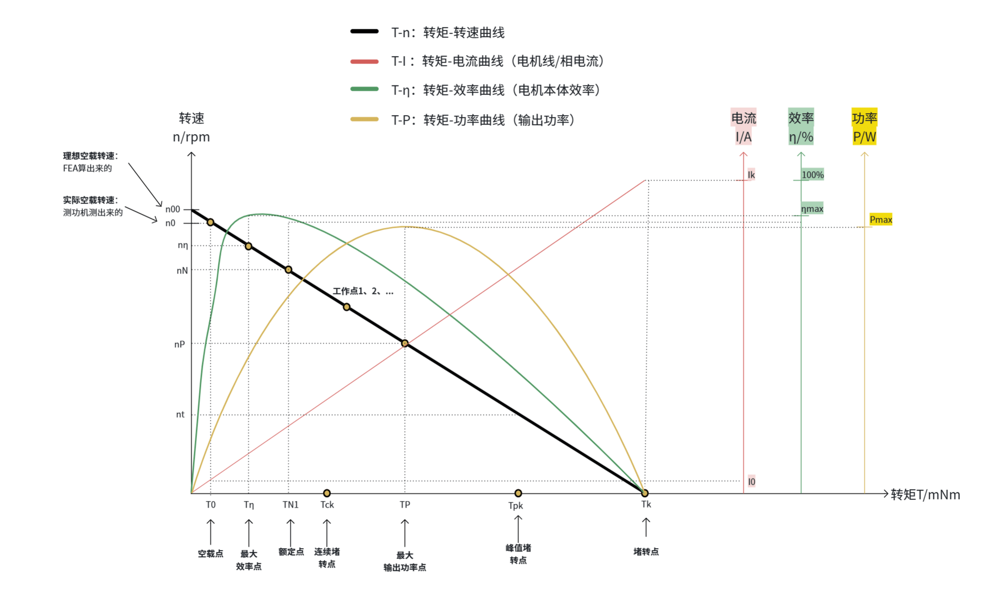 X横坐标——转矩 T Y纵坐标——转速 n | 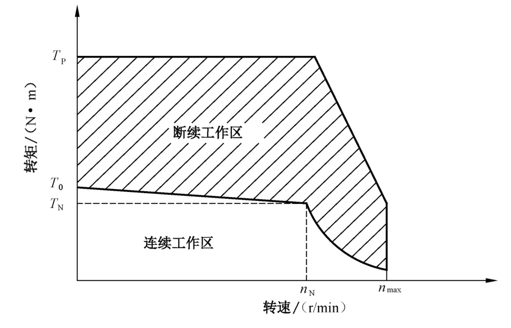 X横坐标——转速 n Y纵坐标——转矩 T |
| 此类型电机，运行轨迹仅在黑色的直线上 从电机测试角度，我们可以通过测功机，直观的控制转矩T（自变量），转速自然而然的变化（随变量），所以横坐标是转矩T | 此类型电机，运行轨迹，是包络线里面的整个面 从电机控制和应用的角度，驱动器可以通过位置传感器，直接采集电机转速，达到控制转速的目的，故此时转速是（自变量），转矩成为（随变量），所以横坐标是转速n |
| 此图，是电机本体设计的基本理论，一般电机设计工程师用的 | 此图，是电机+控制器的应用范围，一般电机设计工程师+电机选型人员用的 |

#### 电机外特性曲线（有刷直流/开环无刷直流）

说明：

- 大部分电机设计边界：功率质比（输出功率/电机重量），在相同的热模型下，功率质比越大，电机发热越大。电机的最终温度成为电机设计的硬性边界。
- 同一个电机，在不同热模型、不同工作点、不同工作制、不同工作工况、不同控制等情况下，输出性能均不相同（大部分情况，性能差距极大）。

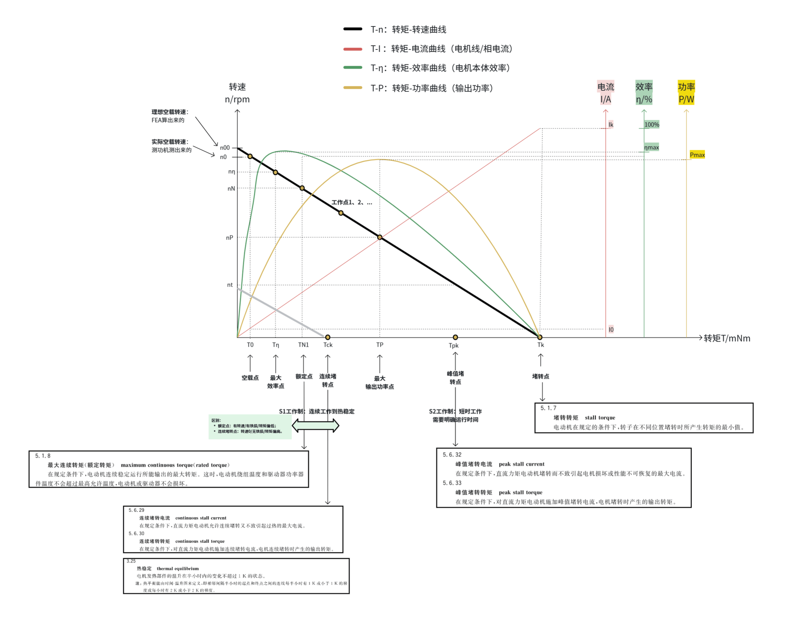

#### 电机外特性曲线（闭环无刷直流）——最大能力包络线

当有驱动控制器进行控制（转速/转矩/位置等）时，电机的外特性曲线工作区域变大，从一条直线变成一个面，更灵活。——此图为电机原理性最大能力（样本中没有），并非某特定电机的工作TN曲线图，样本选型TN曲线见2.2.3。

PS. 下图是大部分力矩电机情况，各工作点的位置前后仅为常规示例，并非一定如此。

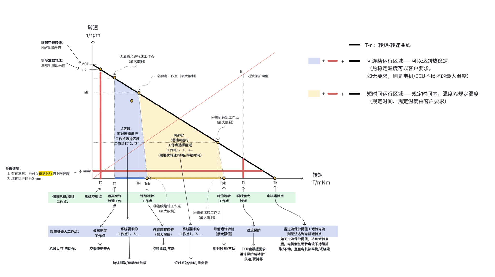

#### 电机外特性曲线（闭环无刷直流）——电机应用的T-n曲线

<!-- 待补截图：飞书画板 74（2.2.4 电机应用的T-n曲线，连续/断续工作区包络图），另存为 分享1：机器人无刷力矩电机选型及应用（20261029）/wb-74.png -->

#### 电机关键术语定义（讨论稿）

##### 术语

PS.所有工作点的确定，都需要6个指标同时具备：电压、转速、转矩、电流、持续工作时间（或给出明确的工作制）、最高温度（客户要求/模组电机不损坏能承受的最高温度）。

| 机器人/灵巧手 动作 | 对应电机 工作点 | 性能 | 备注 |
| --- | --- | --- | --- |
| 额定电压 |  |  | 驱动器端的母线电压 |
| 空载快速开合 | 最高允许速度工作点 @连续运行/给出持续时间 | 转矩 | 样本无，需咨询供应商 |
|  |  | 转速 | 选型样本有（有时也叫最高转速/最大转速/峰值转速/极限转速） |
|  |  | 电流 | 样本无，需咨询供应商 |
|  |  | 温升K | 室温+温升=最终温度/还要规定该温度的位置 连续运行稳定温升需要向供应商咨询 |
| 持续抓取 运动 轻负载 | 可连续运行区域内的任何点，工作点1、2、3、... @连续运行/给出持续时间 | 转矩 | 样本无 确定工作点后，需与供应商确认，电机性能是否覆盖 一般情况下，供应商货架产品的ECU中无此工作点，需要额外增加，连续运行稳定温升需要向供应商咨询 |
|  |  | 转速 |  |
|  |  | 电流 |  |
|  |  | 温升K | 室温+温升=最终温度/还要规定该温度的位置 连续运行稳定温升需要向供应商咨询 |
| 持续抓取 运动 额定负载 | 额定工作点 @连续运行/给出持续时间 | 转矩 | 模组样本：一般有（供应商内部定义一般不同，样本也无） 无框力矩电机样本：大部分没有，以连续堵转转矩代替 （如需要向供应商咨询） |
|  |  | 转速 |  |
|  |  | 电流 |  |
|  |  | 温升K | 室温+温升=最终温度/还要规定该温度的位置 连续运行稳定温升需要向供应商咨询 |
| 持续抓取 不运动 连续堵转负载 | 连续堵转工作点 @连续运行/给出持续时间 | 转矩 | 模组样本：一般没有（如需要向供应商咨询） 无框力矩电机样本：一般有 堵转转速默认为0，样本无 |
|  |  | 转速 |  |
|  |  | 电流 |  |
|  |  | 温升K | 室温+温升=最终温度/还要规定该温度的位置 连续运行稳定温升需要向供应商咨询 |
| 短时抓取 运动 重负载 | 短时运行区域内的任何点，工作点1、2、3、... @给出持续时间 | 转矩 | 样本无 确定工作点后，需与供应商确认，电机性能是否覆盖 一般情况下，供应商货架产品的ECU中无此工作点，需要额外增加，连续运行稳定温升需要向供应商咨询 |
|  |  | 转速 |  |
|  |  | 电流 |  |
|  |  | 温升K | 室温+温升=最终温度/还要规定该温度的位置 连续运行稳定温升需要向供应商咨询 |
| 短时抓取 运动 重负载 | 峰值转矩工作点 @给出持续时间 | 转矩 | 样本无 确定工作点后，需与供应商确认，电机性能是否覆盖 一般情况下，供应商货架产品的ECU中无此工作点，需要额外增加，连续运行稳定温升需要向供应商咨询 |
|  |  | 转速 |  |
|  |  | 电流 |  |
|  |  | 温升K | 室温+温升=最终温度/还要规定该温度的位置 连续运行稳定温升需要向供应商咨询 |
| 短时抓取 不运动 峰值堵转负载 | 峰值堵转工作点 @给出持续时间 | 转矩 | 模组样本：一般没有（如需要向供应商咨询） 无框力矩电机样本：一般有 堵转转速默认为0，样本无 |
|  |  | 转速 |  |
|  |  | 电流 |  |
|  |  | 温升K | 室温+温升=最终温度/还要规定该温度的位置 连续运行稳定温升需要向供应商咨询 |
| 瞬时输出大力矩 而后断电保护 失速 | 瞬时最大转矩工作点 @瞬间 | 转矩 | 样本无，如需要向供应商咨询 |
|  |  | 过流保护阈值 |  |
| 短时抓取 不运动 | 电机堵转工作点 @给出持续时间 | 转矩 | 伺服电机一般情况，最大转矩＜电机堵转转矩，没有此工作点； 特殊情况下，如果存在该点，工况为短时抓取/不运动/重负载； 样本无，（如需要向供应商咨询） |
|  |  | 转速 |  |
|  |  | 电流 |  |
|  |  | 温升K | 室温+温升=最终温度/还要规定该温度的位置 连续运行稳定温升需要向供应商咨询 |

##### 无刷力矩电机名词定义——初版，有疑问可以联系讨论

###### 主要性能名称在重要标准定义

**额定转矩**：在规定条件下，电动机所能输出的最大转矩，在该转矩连续运行，电动机绕组温度和驱动器功率器件温度不会超过最高允许温度，电动机或驱动器不会损坏。（GB/T 21418-2008 永磁无刷电动机系统通用技术条件）(GB/T 2009.26-2008 电工术语 控制电机)

**额定电流**：在规定条件下，电动机输出最大连续转矩（额定转矩）时的线电流，该电流在电动机方波运行时为峰值，正弦波运行时为有效值。（GB/T 21418-2008 永磁无刷电动机系统通用技术条件）(GB/T 2009.26-2008 电工术语 控制电机)

**额定转速**：电动机输出最大连续转矩（额定转矩）并以额定功率运行时的转速。（GB/T 21418-2008 永磁无刷电动机系统通用技术条件）

**额定电压**：在规定条件下，施加在驱动器的电源端子处电压有效值。（GB/T 21418-2008 永磁无刷电动机系统通用技术条件）

**峰值转矩**：在规定条件下，电动机能输出的最大转矩。在峰值转矩下短时工作不会引起电机损坏或性能不可恢复。

**峰值电流**：在规定条件下，电动机输出峰值转矩时的线电流值。在电流在电动机方波运行时为峰值，正弦波运行时为有效值；恒定直流供电运行时为直流电流值。(GB/T 2009.26-2008 电工术语 控制电机)

**最高允许转速**：电机在保证电气绝缘介电强度和机械强度条件下允许的最高转速。

**连续堵转转矩**：在规定条件下，对直流力矩电动机施加连续堵转电流，电动机连续堵转时产生的输出转矩；（GB/T 21418-2008 永磁无刷电动机系统通用技术条件）

**连续堵转电流**：在规定条件下，直流力矩电机允许连续堵转又不至于引起过热的最大电流。（GB/T 21418-2008 永磁无刷电动机系统通用技术条件）

###### 无刷力矩电机名词定义及依据

通用标准定义中，存在未确定项，根据机器人关节实际工况及市场共识，在国家标准基础上，完善电机主要参数定义如下（标红）：

**PS.此定义为初版，有不同考虑可以随时联系，实时更新。**

### 上述类型电机特点对比及应用部位（不同点）

一般地说，各种类型电机只是特点不同，并无绝对的好坏之分。目前为止，还没有一种类型电机，所有指标都最优。

在不同应用场景，选择合适电机类型，多使用该类型电机优势，才可以将系统性能发挥到更优。

PS. 下表中的数值仅为示例，为了大家可以直观感受各类电机的差距，并非实际该类电机的数值范围。

每种电机根据体积、电压不同，转速转矩的范围很大。

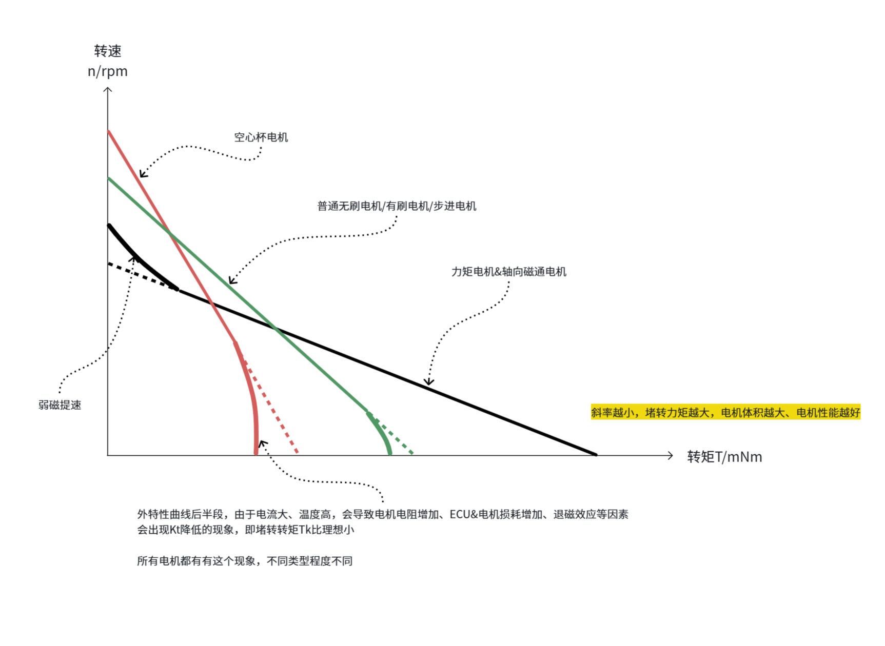

## 电机选型要求

提足够详尽的要求，做足够完整的验证

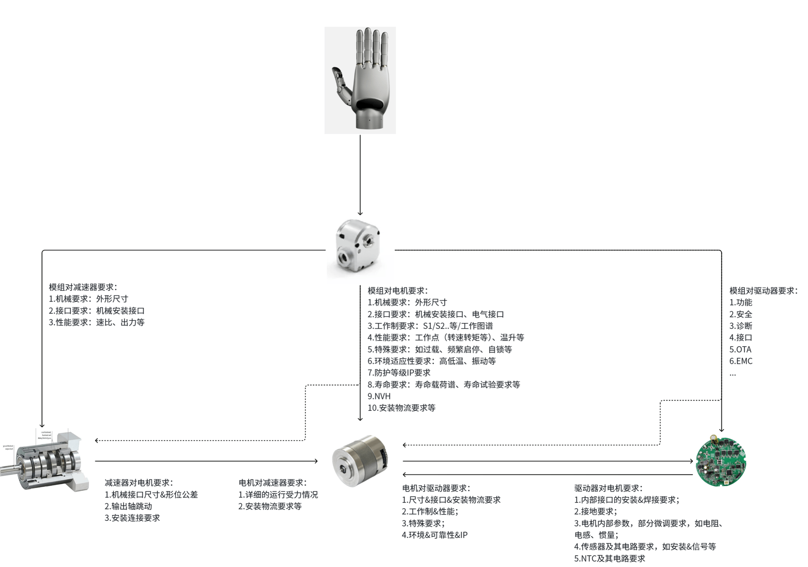

### 电机外形&接口要求

本部分需要提出的要求包括：

- 电机所有外形尺寸、公差、形位公差，特别是具有装配关系的面；
- 电机输出轴要求：跳动、轴向窜动、轴伸尺寸等；
- 如果与整机有焊接等特殊装配要求，明确对电机壳体材料、表面处理的要求；
- 电气接口要求：电机ICD信息、引出线要求（种类、材料、颜色、尺寸、公差、位置等）

示例：

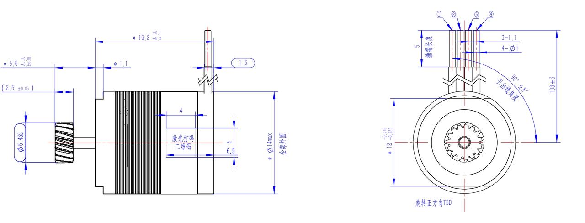

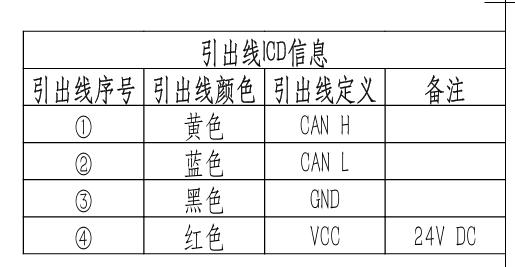

### 电机性能要求

主要的性能要求如下，具体产品具体分析，会有不同。示例如下：

|  |  |  | **电机型号XXX** | **备注** |
| --- | --- | --- | --- | --- |
|  |  | **单位** |  |  |
| **对应灵巧手工作点** | **参数** |  |  |  |
| 额定电压 |  | VDC | 24~26 | 驱动器母线端电压/给出电压公差 |
| 最高允许转速工作点 @连续运行/或给定时长 | 转矩1 | mNm | ≥2 | 电机输出轴转矩/给公差 |
|  | 转速1 | rpm | ≥10000 | 电机输出轴转速/给公差 |
|  | 电流1 | A | ≤ 1 | 驱动器母线电流/给公差 |
|  | 温升1 | K | ≤ 130 | 明确位置，如机壳/给公差 |
| 额定工作点 @连续运行/或给定时长 | 转矩1 | mNm | ≥6.9 | 电机输出轴转矩/给公差 |
|  | 转速1 | rpm | ≥10000 | 电机输出轴转速/给公差 |
|  | 电流1 | A | ≤ 1 | 驱动器母线电流/给公差 |
|  | 温升1 | K | ≤ 130 | 明确位置，如机壳/给公差 |
| 连续堵转工作点 @连续运行/或给定时长 | 转矩2 | mNm | ≥13.5 | 电机输出轴转矩/给公差 |
|  | 转速2 | rpm | 0 |  |
|  | 电流2 | A | ≤ 3 | 驱动器母线电流/给公差 |
|  | 温升2 | K | ≤ 130 | 明确位置，如机壳/给公差 |
| 峰值转矩工作点 @需要明确运行时长 | 转矩3 | mNm | ≥25 | 电机输出轴转矩/给公差 |
|  | 转速3 | rpm | 0 |  |
|  | 电流3 | A | ≤ 5 | 驱动器母线电流/给公差 |
|  | 温升3 | K | ≤ 130 | 明确位置，如机壳/给公差 |
| 峰值堵转工作点 @需要明确运行时长 | 转矩3 | mNm | ≥25 | 电机输出轴转矩/给公差 |
|  | 转速3 | rpm | 0 |  |
|  | 电流3 | A | ≤ 5 | 驱动器母线电流/给公差 |
|  | 温升3 | K | ≤ 130 | 明确位置，如机壳/给公差 |
| 工作点1、2... @需要明确运行时长 | 转矩4 | mNm | ≥25 | 电机输出轴转矩/给公差 |
|  | 转速4 | rpm | 10000±5% | 电机输出轴转速/给公差 |
|  | 电流4 | A | ≤ 5 | 驱动器母线电流/给公差 |
|  | 温升4 | K | ≤ 130 | 明确位置，如机壳/给公差 |
| 瞬时最大转矩点 | 阈值电流 | A |  | 驱动器母线电流/给公差 |
|  | 最大转矩 | mNm |  | 电机输出轴转矩/给公差 |
| 重量 |  | g | ≤ 25 | 交付状态重量/给公差 |
| 散热方式 |  | / | 自然散热 | 最好给出系统安装零件数模和材料 方便电机做热仿真 |
| 位置传感器 |  | / | 磁性编码器 | 推荐型号MT 6701 |
| 温度传感器 |  | / | NTC | 推荐型号 |
| 噪声 |  | dBA | ≤60 @1m | X/Y/Z三方向，背噪低于23dBA |
| EMC |  | / | TBD | 如需 |
| 寿命 |  | h | 2000（S1） | 明确工作制、载荷谱等信息 |
| 防护等级 |  | / | IP30 |  |
| XX部位 |  | / | 材料名称/牌号 | 如需 |
| ... |  | / | 材料名称/牌号 | 如需 |
| 轴向 |  | Nm | 0 | 给出数值和公差，如不受力为0 |
| 径向 |  | Nm | ≥2 | 给出数值和公差，如不受力为0 |
| 特殊要求请说明 |  |  |  | 如需 |
| 线电阻 |  | Ω | TBD±10% | 如需 |
| 线电感min |  | mH | TBD±30% | 如需 |
| 线电感max |  | mH | TBD±30% | 如需 |
| 转矩常数 |  | mNm/A | TBD | 如需 |
| 转子转动惯量 |  | kg·m^2 | TBD | 如需 |

### 电机工况要求

电机载荷谱，如有特殊的运行情况请说明，比如频繁启停等。

### 电机可靠性要求

主要的可靠性要求如下，具体产品具体分析，会有不同。示例如下：

- **环境要求：**

|  | 使用环境要求 | 贮存环境要求 | 备注 |
| --- | --- | --- | --- |
| 温度 | -10℃ ~ +45℃ | -10℃ ~ +45℃ | 常温25℃ 25℃电机性能满足要求 使用温度范围内，电机可以正常使用，新年允许10%以内性能下降 |
| 湿度 | 相对湿度 ≤95% RH（无结露） | 相对湿度 ≤93% RH（无结露） |  |
| 大气压 |  |  |  |

- **环境适应性要求**

示例如下：

| 序号 | 项目 | 要求 |
| --- | --- | --- |
| 1 | 低温 |  |
| 2 | 高温 |  |
| 3 | 振动 |  |
| 4 | 冲击 |  |
| 5 | 跌落 |  |
| 6 | 恒定湿热 |  |
| 7 | 寿命 |  |
| 8 | 盐雾 |  |
| 9 | ... |  |

Next ——电子团队的何凯：电池方面的分享
