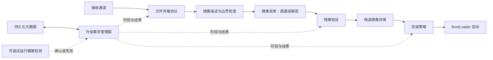

# OTA模块化架构

[← OTA MOC](./MOC.md) | [← 主页](../../index.md)

---

## 架构目标

像 FOC 的坐标变换一样，每个模块接收约定的数据，完成自己的处理，再交出约定的结果。模块不需要知道整台产品怎样组装。

“万物皆插件”指具体实现可以替换，不代表所有职责都能省略。接收、验证、存储、安装、启动必须有人完成；UART、Ymodem、AES、A/B、RTOS 则是实现选择。

## 数据链与控制线

这是职责与数据关系图，不要求把整份固件依次放进 RAM。验证可以随写入增量计算，在存储完成后读回验证；镜像变换也可以读取暂存包，生成独立的候选镜像。具体调度属于产品组装。

| 数据契约 | 内容 | 约束 |
| --- | --- | --- |
| 接收字节 | 字节、有效长度、超时或链路错误 | 不附带 Flash 地址 |
| 文件块 | 会话标识、文件偏移、有效长度、数据 | 去重后按序提交，末包剔除协议填充 |
| 镜像描述 | 格式版本、目标硬件、包长度、安装长度、算法标识 | 长度分别校验，不能把密文长度当运行镜像长度 |
| 候选镜像 | 镜像标识、逻辑区域、有效长度、验证结果 | “收完”和“允许安装”是不同状态 |
| 安装结果 | 可启动镜像标识、结果、恢复信息 | 失败不得产生成功启动凭据 |
| 健康结果 | 试运行镜像标识、确认或失败原因 | 只能确认本次候选镜像 |

## 四种模块关系

| 类别 | 例子 | 选择方式 |
| --- | --- | --- |
| 必需能力的实现插件 | 通道、协议、存储、验证、安装 | 同一职责选择匹配的实现 |
| 可选数据处理中间件 | 解密、解压 | 不启用时直通；镜像声明需要该能力却缺失时拒绝 |
| 可选策略插件 | A/B、试运行回滚 | 替换默认策略，能力缺失时不得承诺对应保障 |
| 可选观察插件 | 日志、UI、进度报告 | 订阅事件，不决定安装成功 |

A/B 是安装策略，不是串在数据流中的字节过滤器；看门狗健康判断是生命周期策略，也不是字节过滤器。统一的是契约和可替换性，不必强行给所有插件同一套函数。

## 插件契约

每个插件都说明：输入、处理、输出、依赖、失败结果、关闭后的行为。接口名称由代码实现决定，笔记只约束语义。

- **数据处理插件：** 开始会话、处理块、结束校验、取消清理。结束可能产生尾部数据；失败后不得提交镜像。
- **存储插件：** 获取区域能力、读、擦、写、冲刷、提交。返回成功的含义必须区分“已接管 RAM 数据”和“已持久化”。
- **安装策略：** 选择目标、准备、安装、恢复、提交启动选择。是否支持回滚由能力声明决定。
- **验证插件：** 开始、增量计算、最终比较，必要时读回校验。签名验证还需定义信任根和受保护字段。
- **平台端口：** 时间、复位、启动交接、必要的临界区。平台依赖只进入端口实现。

初始化时校验能力组合：区域容量、擦写对齐、运行地址、包算法、验证策略和恢复方式不匹配，就拒绝启动会话。嵌入式通常用编译期裁剪与初始化注入即可，不要求动态装载。

## 依赖与所有权

核心只依赖契约；插件依赖契约与平台端口；产品层选择实现并注入资源。核心不直接包含某颗 Flash、某个 UART、AES 实现、UI 或 RTOS 的头文件。

一个会话拥有自己的偏移、变换上下文、验证上下文和存储事务。缓冲区什么时候可以复用必须明确；禁止用共享“当前长度”解释队列中的旧数据。

插件的取消要能停止后续写入、释放资源、留下明确的恢复状态。单个错误汇总给事务管理器，由它决定重试、终止或恢复，插件不各自复位整机。

## 笔记边界

每篇模块笔记记录能力和约束，不规定任务数量、具体命令、确认界面、器件型号或固定调用顺序。产品中的资源申请、地址分配、插件组装和移植步骤属于具体工程。

本目录的新模块笔记是重写代码的架构依据；旧教程单独保留，不代表新架构已有对应实现。
