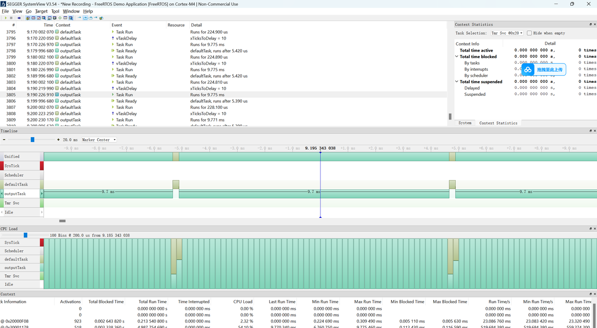
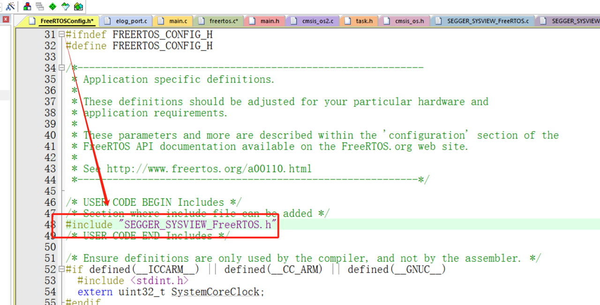
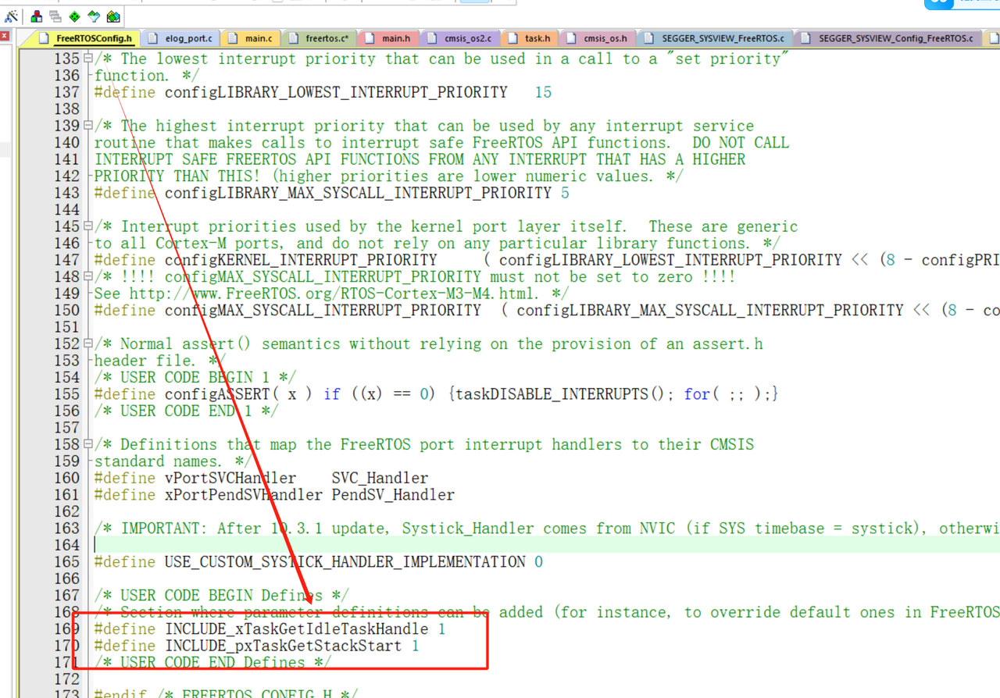

# Systemview

[← 返回 debug方法](./MOC.md) | [← 主页](../../index.md)

> SEGGER Systemview 实时事件录制与可视化

---

## 原理

和[EasyLogger](EasyLogger.md)不同，

SystemView 不会打包日志，因为这会增加运行时算力开销(相对于EasyLogger一个日志要50个字节,这个可能只要2到4个字节)

他会放一帧数据到[RTT](RTT/MOC.md)缓冲区:

| 字段     | 说明                                           |
| -------- | ---------------------------------------------- |
| 事件类型 | 标识任务切换、中断进入/退出、任务创建等事件    |
| 时间戳   | 记录事件发生的时间，使用类似 LEB128 的变长编码 |
| 对象标识 | 标识任务、中断或其他被跟踪对象                 |
| 事件参数 | 根据事件类型记录任务优先级、状态等附加信息     |

对于时间戳,使用了一种类似LEB128的变长压缩算法,如果时间差很小,时间戳只占一个字节,如果差的很大,才用到两个字节

### 那他是怎么知道任务切换,中断切换的呢?

* 他利用了RTOS提供的跟踪宏接口和钩子函数（`traceTASK_CREATE`、`traceTASK_SWITCHED_IN`、`traceTASK_SWITCHED_OUT`）
  当把SystemView 加进工程时，SystemView 的头文件（SEGGER_SYSVIEW_FreeRTOS.h）会暴力覆盖这个宏

### 那他是怎么知道时间的呢?

* 不同于Easylogger,他直接读ARM Cortex-M 内核里的硬件寄存器:[DWT](DWT.md)Cycle Counter 计数器或者[systick定时器](../Cortex-M4内核原理/systick.md)

### 那这些帧里的任务地址是怎么翻译成任务名的呢?

* 这是因为在刚跑起来初始化或者空闲任务的时候,SystemView会发送给电脑一些长的数据包,这些数据包里记录了这些地址对应的函数名

## 效果

SystemView 将这些事件数据以图形化的方式展现，为后续调整任务优先级和分析程序调用链提供依据。



## 移植教程:

> [立芯嵌入式](https://twd6onxsxva.feishu.cn/docx/AzZRdjhewoZSHnxj4i6cANgsnAh)
>
> [软件下载链接](https://pan.baidu.com/s/1Pj8yoqYs0g3AuMM01VQF8w?pwd=vstc&_at_=1792110291199)(官网没有配套文件,必须用这个来自课程文件里的)

### GD32G553 + FreeRTOS V11.1.0 实测步骤

本次环境：GD32G553 Cortex-M33、Keil ARMClang V6.19、FreeRTOS Kernel V11.1.0、SystemView V3.60d、J-Link，工程为 relay_v2。

#### 1. 加入源文件与包含路径

将以下源文件加入 Keil 工程：

- `Systemview/SEGGER/SEGGER_RTT.c`
- `Systemview/SEGGER/SEGGER_RTT_printf.c`
- `Systemview/SEGGER/SEGGER_SYSVIEW.c`
- `Systemview/Sample/FreeRTOSV11/SEGGER_SYSVIEW_FreeRTOS.c`
- `Systemview/Sample/FreeRTOSV11/Config/Cortex-M/SEGGER_SYSVIEW_Config_FreeRTOS.c`

在 Options for Target → C/C++ → Include Paths 中添加以下路径，相对于 `Project/MDK-ARM`：

```text
..\..\Systemview\SEGGER
..\..\Systemview\Config
..\..\Systemview\Sample\FreeRTOSV11
```

只添加 `Sample` 不够，编译器不会自动搜索其子目录。当前内核为 V11，使用 FreeRTOSV11 适配文件。

#### 2. 配置 FreeRTOS 跟踪钩子

**1.3.3 初始化 SystemView**

在 `main.c` 中添加头文件：

```c
#include "SEGGER_SYSVIEW.h"
```

在初始化代码中调用：

```c
SEGGER_SYSVIEW_Conf();
```

**1.3.4 修改 FreeRTOS**

在 `FreeRTOSConfig.h` 中添加头文件和宏定义：

```c
#include "SEGGER_SYSVIEW_FreeRTOS.h"

#define INCLUDE_xTaskGetIdleTaskHandle 1
#define INCLUDE_pxTaskGetStackStart 1
```





#### 3. 使用 RTT 的 C 实现（编译不成功再用）

在 `Systemview/Config/SEGGER_RTT_Conf.h` 的头文件保护范围内加入：

```c
#define RTT_USE_ASM 0
```

本次采用此方法，未加入 RTT 汇编文件。若默认启用汇编却没有编译对应实现，链接会报：

```text
Undefined symbol SEGGER_RTT_ASM_WriteSkipNoLock
```

C 实现仍支持 SystemView 实时采集。

#### 5. 修复电脑端 J-Link DLL 加载（点击 Start Recording 没反应）

本次点击 Start Recording 没反应，检查发现 Windows 注册的 J-Link 安装路径已失效，且 SystemView 目录没有 J-Link DLL。

关闭 SystemView，将实际安装目录中的：

```text
D:\toolchains\Jlink\JLink_V986a\JLink_x64.dll
```

复制到：

```text
D:\toolchains\SystemView_Windows_V360d_x64\
```

重启 SystemView 后，即可打开完整的 J-Link 录制配置窗口。DLL 位数需与 SystemView 一致，本次均为 64 位。以上是本机路径，其他电脑使用实际安装路径。

#### 5. 配置连接并开始采集（有反应了但是不成功）

1. 保持板子供电、程序运行，不停在调试断点。
2. 打开 Target → Recorder Configuration（Alt + Enter），选择 **J-Link**。
3. 点击 Target → Start Recording（F5），出现完整连接配置时填写：

 RTT Control Block Address ： 0x20000030，以最新 map 为准（这个自己测试）

4. 点击 OK，开始实时采集。
