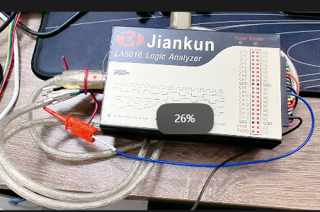
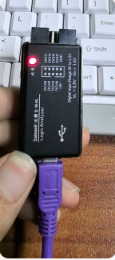
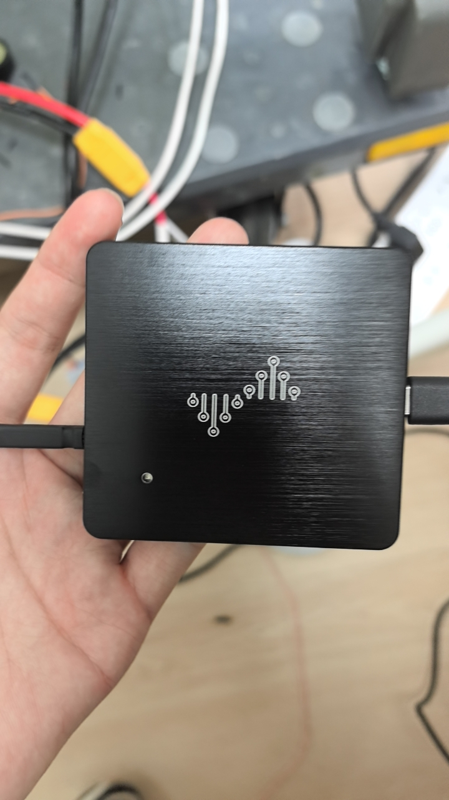

# 逻辑分析仪

[← 返回 嵌入式外部工具使用记录](./MOC.md) | [← 主页](../../index.md)

---

这个是我比较喜欢用的一款,[软件安装下载官网](https://www.qdkingst.com/cn/download-vis),太贵了

这个是便宜的国产,采集点时间间隔越来越大,避雷,最后用旁边的示波器一点一点肉眼翻译😭

现在用这个了,[购买链接(DSlogic)](https://item.taobao.com/item.htm?id=43809938149&mi_id=0000i3ELxXiaLU3_x3PvWACgjPAWhb9be8bsA0bPGqCeTkE&spm=tbpc.boughtlist.suborder_itemtitle.1.78422e8dj4nwz6)

---

## 本章小结
